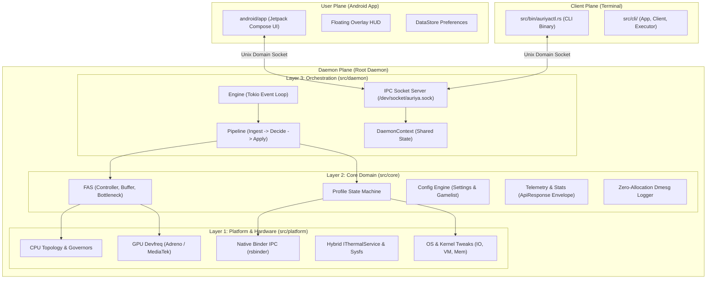

Auriya is organized into two runtime planes (the Android Jetpack Compose Manager App and the aarch64 Rust Daemon) and structured into clean architectural layers with `mod.rs` facades. This page details each subsystem, where it lives in the repository, and what it owns.

## Android Manager App — `android/app/`

The user-facing management application (package `dev.auriya.app`):
- **User Interface**: Built with modern Jetpack Compose and Material 3 Monet dynamic theming with lifted dark mode and AMOLED deep graphite contrast.
- **Floating Overlay HUD**: Draggable real-time telemetry island with smooth sub-pixel float accumulation, orientation-aware screen margins, and dynamic layout adaptation (single-row island for $\le 3$ metrics, vertical stacked column for $> 3$ metrics).
- **Compiler Stability**: All stats and telemetry models are annotated with `@Immutable` to ensure smart recomposition skipping.
- **Data Persistence**: Settings are managed via AndroidX DataStore Preferences (`AppPrefs.kt`, `AutoRecordPrefs.kt`).
- **Telemetry Streaming**: Connects as a client to the daemon's Unix domain socket (`/dev/socket/auriya.sock`) via root shell streaming, consuming the standardized `ApiResponse<Stats>` JSON envelope.

## Shared Kotlin — `android/shared/`

Shared data classes, TOML parser utilities, and root shell execution helpers (`RootShell.kt`) used across the Android app modules.

## Rust Daemon — `src/main.rs` & `src/`

The compiled root binary (`auriya`). Runs continuously in the background, consuming zero CPU cycles when idle. It is structured into three distinct layers:

### Layer 1: Platform Adapters — `src/platform/`
Encapsulates all direct hardware interactions, sysfs paths, and Android OS interfaces:
- **`platform/binder/`**: Direct Native Binder IPC using `rsbinder`:
  - `IActivityManager` (`ProcessObserver`): Real-time foreground event callbacks (`onForegroundActivitiesChanged`, `onProcessDied`).
  - `INotificationManager`: Native Do Not Disturb actuator (`setInterruptionFilter`).
  - `IDisplayManager`: Native refresh rate switching and display mode query.
  - `IPowerManager`: Screen interactive state detection (`isInteractive`).
  - `IWifiManager`: Low-latency Wi-Fi gaming lock (`acquireWifiLock`).
  - `IActivityTaskManager`: Multi-window / freeform 30 FPS cap detection.
  - `IThermalService`: Hybrid framework thermal query with sysfs fallback.
- **`platform/cpu/`**: CPU cluster topology detection (Little/Big/Prime), governor switching, frequency scaling, and ceiling overrides.
- **`platform/gpu/`**: Adreno (KGSL) and MediaTek (`gpufreq`) devfreq scaling and power mode toggles.
- **`platform/thermal/`**: Thermal zone reader, throttling state detection, and multi-SoC temperature aggregation.
- **`platform/common/`**: Kernel tweaks: I/O schedulers, virtual memory (`swappiness`, `vfs_cache_pressure`), touch panel boost, and kernel task scheduler optimizations.

### Layer 2: Core Domain Logic — `src/core/`
Implements hardware-independent decision engines and algorithms:
- **`core/fas/`**: Frame-Aware Scheduling:
  - `buffer.rs`: Frame-time history buffer and presentation-time tracking.
  - `bottleneck.rs`: Real-time bottleneck classification (`CpuBound`, `GpuBound`, `Calm`).
  - `controller.rs`: PID controller modulating frequencies to track target frame rates while maintaining thermal stability.
- **`core/profile/`**: Profile definitions (`Powersave`, `Balance`, `Performance`, `Fast`) and transition logic.
- **`core/config/`**: Configuration models (`settings.toml`, `gamelist.toml`) and inotify change detection.
- **`core/stats/`**: Telemetry models, 0.1% low calculations, presentation-time weighted frame drops, and the standardized `ApiResponse<T>` envelope.
- **`core/logger/`**: Zero-allocation dmesg-style direct file writer engine with boottime precision stamps, zero stderr heap overhead, and automatic log rotation.

### Layer 3: Orchestration & Server — `src/daemon/`
Coordinates the lifecycle and event-driven execution:
- **`daemon/context.rs`**: Central `DaemonContext` holding atomic state, shared hardware handles, and channel senders.
- **`daemon/engine.rs`**: Main Tokio event loop, graceful termination handler, and signal dispatcher.
- **`daemon/pipeline.rs`**: Structured execution cycle: `ingest` $\rightarrow$ `decide` $\rightarrow$ `apply` $\rightarrow$ `fas_tick`.
- **`daemon/ipc/`**: Unix domain socket server (`/dev/socket/auriya.sock`), parsing client commands and streaming structured JSON telemetry.

## Control CLI — `src/bin/auriyactl.rs` & `src/cli/`

Standalone command-line binary (`auriyactl`) compiled from the same repository:
- Provides headless management without needing the Android application.
- Supports commands: `auriyactl status`, `auriyactl profile <mode>`, `auriyactl restart`, and `auriyactl dump`.
- Interacts with the daemon exclusively through `/dev/socket/auriya.sock`.
