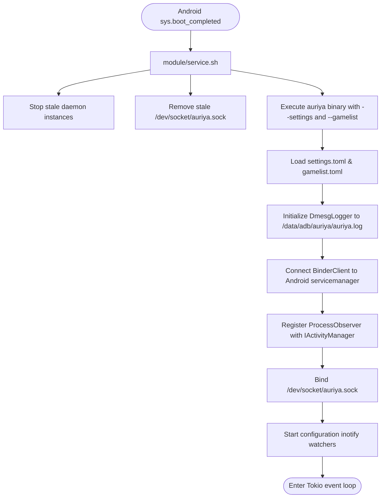

Auriya organizes runtime data flow into two distinct streams: **control commands** (client requests to adjust profiles, tuning, or state) and **telemetry streaming** (real-time hardware metrics and frame statistics). All interactions flow with zero disk overhead through Native Binder IPC and a dedicated Unix domain socket.

## End-to-End System Flow

```mermaid
flowchart TD
    subgraph Client ["Client Plane"]
        app["Manager App (Jetpack Compose)<br/><code>dev.auriya.app</code>"]
        ctl["Control CLI<br/><code>auriyactl</code>"]
    end

    sock["Unix Domain Socket<br/><code>/dev/socket/auriya.sock</code>"]

    subgraph Daemon ["Auriya Rust Daemon (aarch64)"]
        ipc["IPC Server & Command Dispatcher"]
        pipeline["Pipeline (Ingest -> Decide -> Apply)"]
        fas["FAS Controller & FrameBuffer"]
        binder["Native Binder (rsbinder)"]
    end

    subgraph AndroidOS ["Android OS & Kernel"]
        fw["Android System Services<br/><code>IActivityManager</code> · <code>INotificationManager</code> · <code>IWifiManager</code>"]
        kernel["Kernel Sysfs & Procfs<br/><code>/proc/stat</code> · <code>/sys/class/thermal</code> · <code>/sys/devices/system/cpu</code>"]
    end

    app <-->|"GET_STATS / SET_PROFILE"| sock
    ctl <-->|"Commands & Dumps"| sock
    sock <-->|"JSON Request / ApiResponse<T>"| ipc
    ipc --> pipeline

    fw -->|"onForegroundActivitiesChanged (Callback)"| binder
    binder -->|"Event Stream (mpsc)"| pipeline
    pipeline -->|"RPC: DnD / Refresh Rate / Wi-Fi Lock"| fw

    pipeline --> fas
    fas -->|"Governors / Frequency Ceilings / Devfreq"| kernel
    kernel -->|"Readings: Clocks / CPU Load / Temperatures"| pipeline
```

## Communication Channels

| Channel | Protocol / Medium | Direction | Purpose |
| :--- | :--- | :--- | :--- |
| **Unix Domain Socket** | Line-delimited JSON (`/dev/socket/auriya.sock`) | Bidirectional | Client-to-daemon communication: status polling (`GET_STATS`), profile changes, process injection, and debugging. |
| **Native Binder IPC** | Native Android IPC via `rsbinder` (`/dev/binder`) | Bidirectional | Direct framework communication: receiving foreground lifecycle events (`IActivityManager`) and setting DnD, refresh rate, and Wi-Fi locks. |
| **Kernel Sysfs & Procfs** | File descriptor I/O (`/proc`, `/sys`) | Bidirectional | Modulating CPU/GPU governors, reading per-core frequencies, CPU utilization, and thermal zone temperatures. |
| **Config Inotify** | Linux `inotify` watchers | One-way (Disk $\rightarrow$ Daemon) | Instant reload of `settings.toml` and `gamelist.toml` on file modification. |

## Boot Sequence (Cold Start)

The cold-start sequence initializes the daemon directly upon Android boot completion:

## Lifecycle & Telemetry Flow

When an application moves to the foreground:
1. **Event Ingestion**: `IActivityManager` invokes the native Rust callback `ProcessObserver::onForegroundActivitiesChanged`.
2. **Channel Dispatch**: The callback pushes a `ForegroundChanged(package, pid)` event into Tokio's asynchronous `event_tx` channel.
3. **Pipeline Evaluation**: The pipeline's `decide` step matches the package against `gamelist.toml`.
4. **Hardware Application**:
   - If the package is a registered game, the daemon sets the target profile (Performance/Fast), configures frequency ceilings, acquires the low-latency Wi-Fi lock, activates Priority DnD via `INotificationManager`, and switches the display refresh rate via `IDisplayManager`.
   - If the package is not registered, the daemon restores default balanced governors and releases game-specific overrides.
5. **Telemetry Aggregation**: The daemon aggregates CPU, GPU, thermal, battery, and FAS frame stats into the standardized `ApiResponse<Stats>` JSON payload, which is served immediately to the Compose Manager App and floating overlay HUD.
