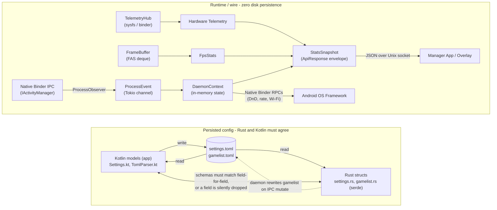

Auriya has no database — its "entities" are configuration files, in-memory
snapshots, and wire payloads that cross the Rust ↔ Android boundary. This page maps
them: what each entity is, **where it lives**, and **which direction it syncs**.
The single most important property here is **Rust ↔ Kotlin schema parity** for the
config entities — the two sides must agree or a field is silently dropped (there is
no `deny_unknown_fields`).

:::info Verified against source
Traced to Auriya v2.2.0.
Rust: `src/core/config/`, `src/daemon/context.rs`, `src/core/stats/`, `src/core/telemetry/`, `src/platform/binder/`.
Kotlin: `android/shared/src/main/kotlin/dev/auriya/shared/model/` + `.../config/TomlParser.kt`.
:::

## Entity map (who owns what, sync direction)



## Config entities (Rust ↔ Kotlin — must stay in sync)

These have **two authoritative definitions** — a Rust struct (what the daemon
consumes) and a Kotlin data class (what the app reads/writes). They are joined by
the TOML file. Keeping them equal is a hard requirement.

### `Settings` ↔ `settings.toml` ↔ `Settings.kt`

| Group | Rust (`settings.rs`) | Kotlin (`Settings.kt`) | Notes |
| --- | --- | --- | --- |
| `[daemon]` | `DaemonConfig { log_level, check_interval_ms, default_mode }` | `DaemonConfig(logLevel, checkIntervalMs, defaultMode)` | Parity |
| `[cpu]` | `CpuConfig { default_governor }` | `CpuConfig(defaultGovernor)` | Parity |
| `[dnd]` | `DndConfig { default_enable }` | `DndConfig(defaultEnable)` | Parity |
| `[fas]` | `FasConfig { enabled, default_mode, thermal_threshold, poll_interval_ms, target_fps }` | `FasConfig(enabled, defaultMode, thermalThreshold, pollIntervalMs, targetFps)` | Parity (all 5) |
| `[dynamic_governor]` | `DynamicGovernorConfig { enabled, cv_threshold, debounce_frames }` | `DynamicGovernorConfig(enabled, cvThreshold, debounceFrames)` | Parity |
| `[modes.*]` | `HashMap<String, FasMode { margin, thermal_threshold }>` | `Map<String, FasMode(margin, thermalThreshold)>` | Parity |

Full per-key meaning + which the daemon consumes: [Settings Reference](/reference/settings/).

### `GameProfile` ↔ `[[game]]` ↔ Kotlin

| Field | Type | Required | Notes |
| --- | --- | --- | --- |
| `package` | string | Yes | whitelist key |
| `cpu_governor` | string | Yes | |
| `enable_dnd` | bool | Yes | |
| `target_fps` | int **or** int[] | — | custom deserializer (`TargetFpsConfig`) |
| `refresh_rate` | int | — | |
| `mode` | string | — | `powersave`/`balance`/`performance`/`fast` |
| `ceiling` | string | — | |

Full detail: [Gamelist Reference](/reference/gamelist/).

:::warning The schema-sync rule
There is no `#[serde(deny_unknown_fields)]`. If you add a key to one side only:
- key in TOML but not the Rust struct → **silently dropped** on load;
- key the app writes but the daemon doesn't read → **dead config** (parsed, no effect).

So a new setting is a **three-place change**: Rust struct (+ consume it),
`settings.toml`/`gamelist.toml` default, and the Kotlin model + `TomlParser`.
Do **not** add a field only one side uses. This is why per-game *UI-only* flags
(e.g. auto-record enable) live in app DataStore Preferences, **not** in `gamelist.toml`.
:::

## Runtime / wire entities (no persistence)

These are transient — computed per tick or per request, never stored to disk.

### `ProcessEvent` (Native Binder → Daemon)

`src/daemon/pipeline.rs`. Dispatched asynchronously from `ProcessObserver` (`src/platform/binder/observer.rs`) or `PidTracker` (`src/core/session/tracker.rs`) over a bounded Tokio mpsc channel.

| Variant | Payload | Origin |
| --- | --- | --- |
| `ForegroundChanged` | `{ pid: i32, pkg: String }` | `IProcessObserver.onForegroundActivitiesChanged` |
| `PidExited` | `{ pid: i32 }` | `pidfd_open` watcher thread blocking in `poll()` |

### `DaemonContext` (in-memory state)

`src/daemon/context.rs`. Central thread-safe state container shared by Tokio pipeline tasks and Unix socket IPC handlers. Holds:
- Atomic flags (`enabled`)
- Active profile state and manual overrides (`override_foreground`, `active_profile`)
- Foreground tracking (`current_pkg`, `current_pid`, `is_game`)
- Controller references (FAS controller, Binder client, Gamelist, Settings, Logger)

### `ApiResponse<T>` & `StatsSnapshot` (`GET_STATS` / `STREAM_STATS`)

`src/core/stats/snapshot.rs`. Assembled per request or continuous stream from `DaemonContext` + `TelemetryHub` + `FrameBuffer`. Wrapped inside standard `ApiResponse<StatsSnapshot>` envelope:

```json
{
  "status": "ok",
  "data": { "daemon": {...}, "binder": {...}, "fps": {...}, ... }
}
```

The app decodes this schema directly to render UI cards and floating HUD metrics. Detailed schema in [Stats API](/reference/stats-api/).

## Lifecycle at a glance

| Entity | Created by | Lives in | Read by | Persisted? |
| --- | --- | --- | --- | --- |
| `Settings` / `GameProfile` | app (or install defaults) | TOML on disk | daemon (startup/watch) | Yes (file) |
| `ProcessEvent` | Native Binder / pidfd | Tokio channel | daemon pipeline | No (RAM stream) |
| `DaemonContext` | daemon boot | RAM | pipeline & IPC handlers | No (RAM only) |
| `StatsSnapshot` | IPC handler | RAM → JSON socket | app / overlay HUD | No (per-request) |
| `ApiResponse<T>` | IPC handler | RAM → wire | app / CLI | No (wire envelope) |
