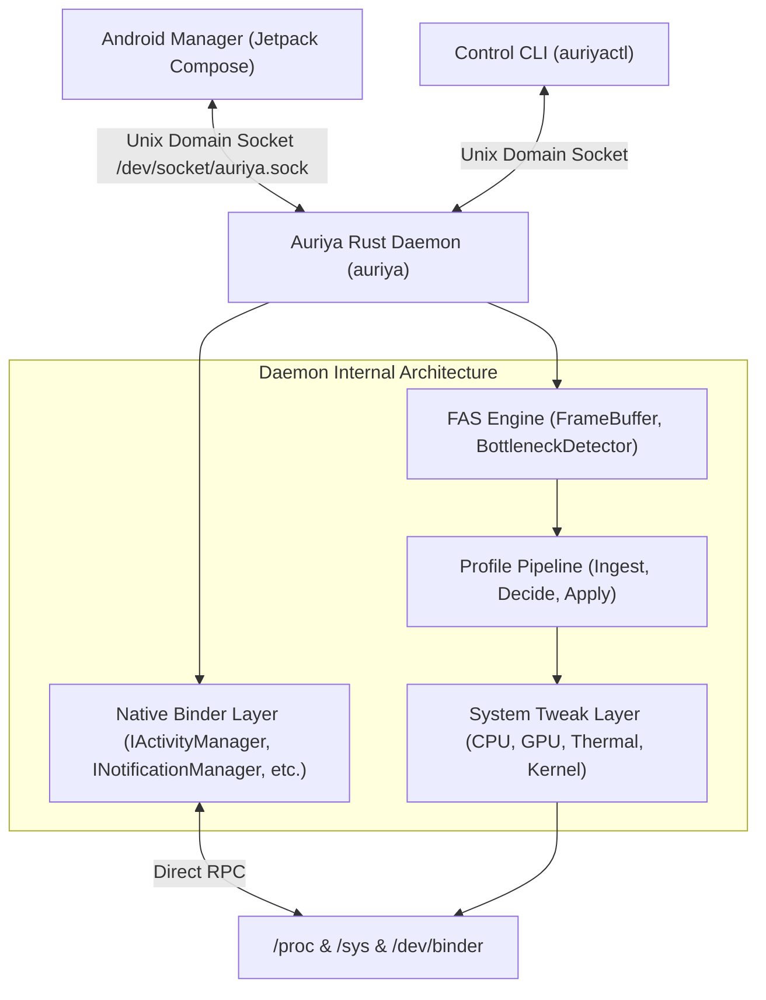
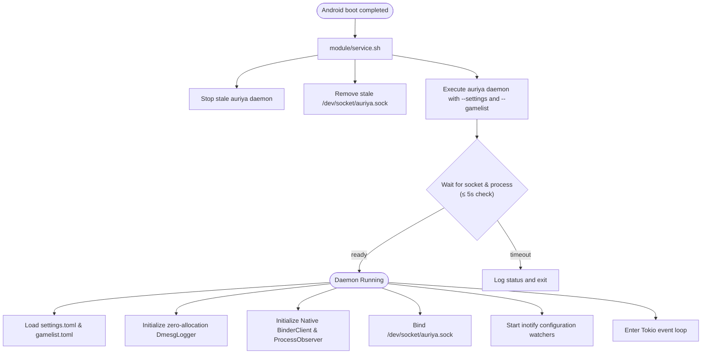
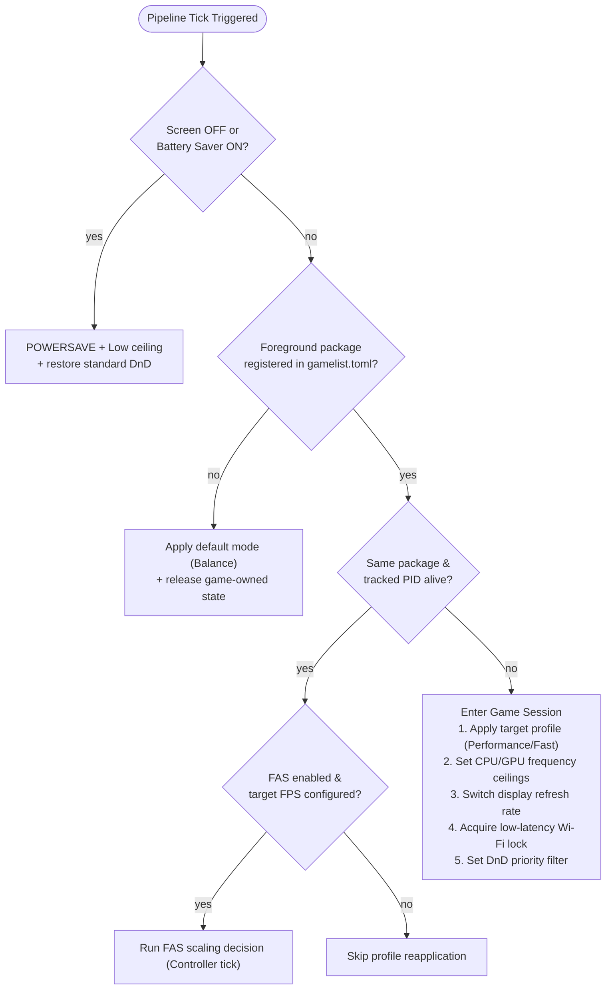

Auriya is a rooted Android performance optimization system composed of two coordinated runtime planes: a modern Jetpack Compose manager application and an `aarch64` Rust daemon. The daemon directly interacts with kernel interfaces (`/proc`, `/sys`) and Android system services via **Native Binder IPC** (`rsbinder`), executing real-time scheduling decisions and zero-disk telemetry streaming.

The Android manager owns user configuration, interactive overlay presentation, and benchmark scrubbing. The Rust daemon owns long-running system observation, frame-aware scheduling, real-time telemetry, and hardware modulation. The `auriyactl` CLI provides a lightweight terminal interface for headless control and automation.

## Binary Execution Workflow

The installed module does not launch the daemon through the Android app. At boot, `module/service.sh` waits for Android's `sys.boot_completed`, stops any stale daemon instances, removes leftover socket files, and launches `/data/adb/modules/auriya/system/bin/auriya` with the installed settings and gamelist paths. Standard output and errors are captured cleanly via the zero-allocation logging engine directly into `/data/adb/auriya/daemon.log`.

## Structured Pipeline Cadence

The daemon event loop is driven by a single-threaded Tokio runtime, cleanly decoupled into an `ingest -> decide -> apply -> fas_tick` pipeline:

| Event Source | Result |
| :--- | :--- |
| **ProcessObserver Callback** | `IActivityManager` reports foreground change (`onForegroundActivitiesChanged`); immediate profile evaluation without polling. |
| **Periodic Tick Timer** | 500 ms in an active game session; 5 seconds during balanced desktop state; 10 seconds when screen is turned off (`IPowerManager.isInteractive() == false`). |
| **Settings / Gamelist Inotify** | Configuration reloaded asynchronously on disk save; governors and profile rules re-evaluated in-place. |
| **Unix Domain Socket Request** | Client queries (`GET_STATS`, `SET_PROFILE`, `INJECT_APP`) processed and answered via JSON response envelope. |
| **SIGINT / SIGTERM** | Graceful shutdown: releases hardware locks, clears ceiling overrides, detaches observers, and unbinds socket. |

## Profile Decision Workflow

The profile pipeline evaluates system state and app identity in strict priority order:

### Profile Modes

Static profiles are applied according to mode definitions in [`src/core/profile/`](https://github.com/pavelc4/auriya/blob/main/src/core/profile):

| Profile | Actions |
| :--- | :--- |
| **Fast** | Maximum responsiveness: sets aggressive governor, enables CPU boost, onlines all CPU cores, applies vendor performance hooks, sets GPU high-performance devfreq, optimizes memory/I/O queues, and sets process affinity. |
| **Performance** | Balanced high-tier gaming: sets performance governor, enables CPU boost, applies Snapdragon/MediaTek optimizations, sets GPU performance mode, and tunes scheduler latencies. |
| **Balance** | Default system state: sets standard energy-aware governor, disables CPU boost, sets balanced GPU devfreq, restores kernel memory and storage scheduler defaults. |
| **Powersave** | Battery conservation: sets CPU governor to `powersave`, lowers frequency ceilings, limits GPU clocks, and relaxes background scheduler ticks. |

### Dynamic FAS Modulation

When inside an active game session with Frame-Aware Scheduling (FAS) active, `FasController` continuously computes PID adjustments to maintain stable frame rates while preventing thermal throttle:

| FAS Action | Applied Adjustment |
| :--- | :--- |
| **BoostGpu** | Escalates GPU devfreq step while keeping CPU at calm target. |
| **BoostCpu** | Escalates CPU cluster frequencies and thread affinity while maintaining GPU step. |
| **BoostBalanced** | Escalates both CPU and GPU frequency steps simultaneously. |
| **Maintain** | Current frequency steps satisfy target frame rate; zero hardware writes. |
| **Reduce** | Relaxes frequency steps down toward energy-efficient floor. |

## Runtime Plane Boundaries

- **Manager App (`android/app`)**: Modern Jetpack Compose UI, Material 3 Monet theming, DataStore Preferences, `@Immutable` models, draggable sub-pixel overlay HUD, and benchmark session review.
- **Shared Kotlin (`android/shared`)**: Shared data classes, serialization models, and root shell execution helpers.
- **Rust Daemon (`src/main.rs`, `src/daemon/`)**: Central event engine, pipeline orchestration (`ingest -> decide -> apply`), Native Binder IPC server, and Unix domain socket handler.
- **Platform Layer (`src/platform/`)**: Native Binder clients (`IActivityManager`, `INotificationManager`, etc.), CPU cluster control, GPU devfreq, and multi-SoC thermal zone readers.
- **Core Domain Layer (`src/core/`)**: Frame-aware scheduling (`FasController`, `BottleneckDetector`), profile state machine, TOML configuration engine, and zero-allocation logging.
- **Control CLI (`src/cli/`, `src/bin/auriyactl.rs`)**: Standalone command-line client interacting with `/dev/socket/auriya.sock`.
