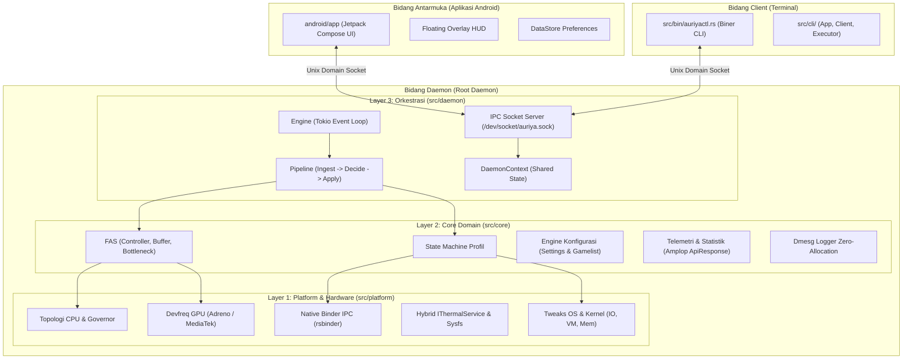

Auriya diatur ke dalam dua bidang runtime utama (Aplikasi Android Jetpack Compose dan Daemon Rust aarch64) dengan arsitektur 3-lapis terstruktur menggunakan `mod.rs` facades. Halaman ini menjelaskan setiap subsistem, lokasinya di dalam repositori, dan tanggung jawabnya.

## Android Manager App — `android/app/`

Aplikasi manajemen antarmuka pengguna (paket `dev.auriya.app`):
- **User Interface**: Dibangun dengan Jetpack Compose modern dan tema dinamis Material 3 Monet dengan kontras tinggi AMOLED deep graphite.
- **Floating Overlay HUD**: Overlay metrik real-time yang bisa digeser dengan akumulasi koordinat sub-pixel float yang sangat mulus, batas layar adaptif, dan layout dinamis (baris tunggal jika $\le 3$ metrik, kolom vertikal jika $> 3$ metrik).
- **Stabilitas Compiler Compose**: Semua model statistik dianotasi dengan `@Immutable` agar compiler melewati recomposition yang tidak diperlukan.
- **Persistensi Data**: Seluruh preferensi dikelola via AndroidX DataStore Preferences (`AppPrefs.kt`, `AutoRecordPrefs.kt`).
- **Streaming Telemetri**: Berfungsi sebagai client soket domain Unix daemon (`/dev/socket/auriya.sock`), mengonsumsi amplop data JSON terstandarisasi `ApiResponse<Stats>`.

## Shared Kotlin — `android/shared/`

Model data bersama, utilitas parser TOML, dan helper eksekusi root shell (`RootShell.kt`) yang digunakan di modul aplikasi Android.

## Rust Daemon — `src/main.rs` & `src/`

Biner root yang terkompilasi (`auriya`). Berjalan terus-menerus di latar belakang dengan konsumsi daya minimal. Terbagi rapi ke dalam 3 lapisan arsitektur:

### Layer 1: Platform Adapters — `src/platform/`
Mengisolasi seluruh interaksi hardware langsung, sysfs, dan antarmuka OS Android:
- **`platform/binder/`**: Native Binder IPC langsung via `rsbinder`:
  - `IActivityManager` (`ProcessObserver`): Callback event aplikasi foreground secara real-time (`onForegroundActivitiesChanged`, `onProcessDied`).
  - `INotificationManager`: Aktuator mode Jangan Ganggu / DnD (`setInterruptionFilter`).
  - `IDisplayManager`: Pengaturan refresh rate dan query resolusi layar.
  - `IPowerManager`: Deteksi status layar menyala/interaktif (`isInteractive`).
  - `IWifiManager`: Kunci Wi-Fi low-latency saat bermain game (`acquireWifiLock`).
  - `IActivityTaskManager`: Deteksi window floating/freeform untuk membatasi 30 FPS.
  - `IThermalService`: Query suhu sistem operasi dengan fallback dinamis ke sysfs.
- **`platform/cpu/`**: Deteksi topologi cluster CPU (Little/Big/Prime), governor switching, dan batas frekuensi.
- **`platform/gpu/`**: Kontrol devfreq Adreno (KGSL) dan MediaTek (`gpufreq`).
- **`platform/thermal/`**: Pembaca thermal zone, deteksi status throttling, dan penggabungan suhu multi-sensor.
- **`platform/common/`**: Optimasi kernel: I/O schedulers, virtual memory (`swappiness`, `vfs_cache_pressure`), touch panel boost, dan scheduler task kernel.

### Layer 2: Core Domain Logic — `src/core/`
Mengimplementasikan algoritma dan mesin keputusan yang independen dari platform:
- **`core/fas/`**: Frame-Aware Scheduling:
  - `buffer.rs`: Buffer frame-time dan pelacakan durasi presentasi frame.
  - `bottleneck.rs`: Klasifikasi bottleneck secara real-time (`CpuBound`, `GpuBound`, `Calm`).
  - `controller.rs`: Pengontrol PID yang menyesuaikan frekuensi untuk mengejar target FPS tanpa kepanasan.
- **`core/profile/`**: Definisi profil (`Powersave`, `Balance`, `Performance`, `Fast`) dan logika peralihannya.
- **`core/config/`**: Parser konfigurasi (`settings.toml`, `gamelist.toml`) dengan pemuatan ulang inotify.
- **`core/stats/`**: Perhitungan 0.1% low, dropped frame berbasis waktu presentasi, dan amplop JSON `ApiResponse<T>`.
- **`core/logger/`**: Engine logging format dmesg zero-allocation dengan timestamp boottime presisi langsung ke file disk.

### Layer 3: Orkestrasi & Server — `src/daemon/`
Mengatur siklus hidup dan eksekusi event-driven:
- **`daemon/context.rs`**: `DaemonContext` terpusat yang menyimpan state thread-safe dan handle hardware.
- **`daemon/engine.rs`**: Event loop utama berbasis Tokio dan handler sinyal terminasi bersih.
- **`daemon/pipeline.rs`**: Siklus eksekusi terstruktur: `ingest` $\rightarrow$ `decide` $\rightarrow$ `apply` $\rightarrow$ `fas_tick`.
- **`daemon/ipc/`**: Server soket domain Unix (`/dev/socket/auriya.sock`) untuk melayani perintah client dan streaming telemetri.

## Control CLI — `src/bin/auriyactl.rs` & `src/cli/`

Biner baris perintah mandiri (`auriyactl`):
- Memungkinkan manajemen modul secara headless tanpa membuka aplikasi Android.
- Mendukung perintah: `auriyactl status`, `auriyactl profile <mode>`, `auriyactl restart`, dan `auriyactl dump`.
- Berkomunikasi dengan daemon secara eksklusif lewat soket `/dev/socket/auriya.sock`.
