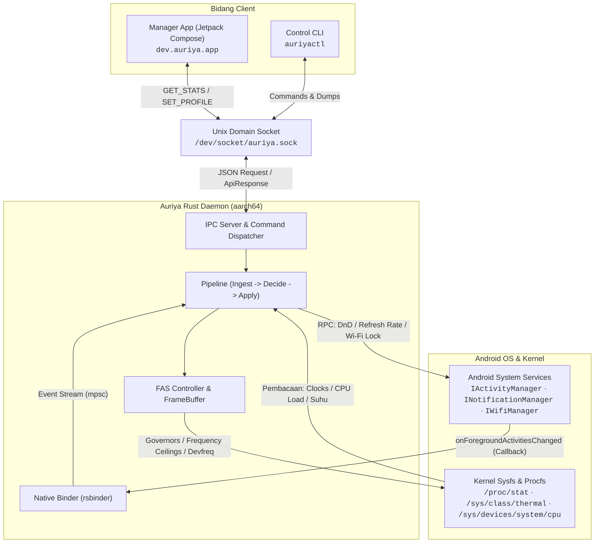
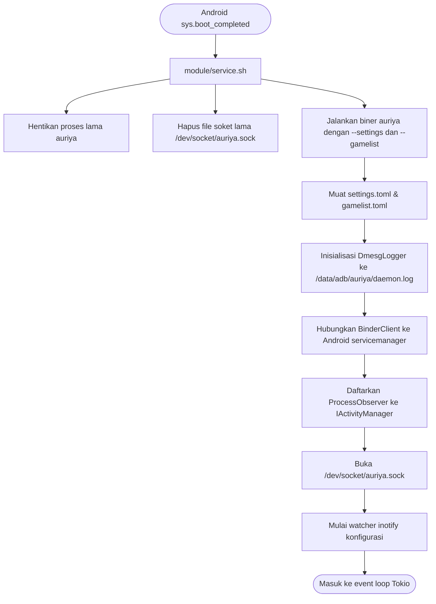

Auriya membagi aliran data runtime menjadi dua jalur utama: **perintah kontrol** (permintaan client untuk mengubah profil, konfigurasi, atau state) dan **aliran telemetri** (pembacaan metrik hardware dan statistik performa frame secara real-time). Seluruh interaksi berjalan tanpa penulisan file disk berulang melalui Native Binder IPC dan soket domain Unix.

## Aliran Sistem End-to-End

## Saluran Komunikasi

| Saluran | Protokol / Media | Arah | Fungsi |
| :--- | :--- | :--- | :--- |
| **Unix Domain Socket** | Line-delimited JSON (`/dev/socket/auriya.sock`) | Dua arah | Komunikasi client-ke-daemon: polling status (`GET_STATS`), pergantian profil, injeksi proses, dan debugging. |
| **Native Binder IPC** | Android IPC native via `rsbinder` (`/dev/binder`) | Dua arah | Komunikasi langsung framework: penerimaan callback foreground (`IActivityManager`), kontrol DnD, refresh rate, dan kunci Wi-Fi low-latency. |
| **Kernel Sysfs & Procfs** | File descriptor I/O (`/proc`, `/sys`) | Dua arah | Modulasi governor CPU/GPU, pembacaan frekuensi per-core, penggunaan CPU, dan suhu thermal zone. |
| **Inotify Konfigurasi** | Linux `inotify` watchers | Satu arah (Disk $\rightarrow$ Daemon) | Pemuatan ulang instan `settings.toml` dan `gamelist.toml` saat file disimpan. |

## Urutan Boot (Cold Start)

Urutan cold-start menginisialisasi daemon langsung setelah boot Android selesai:

## Alur Lifecycle & Telemetri

Saat sebuah aplikasi berpindah ke layar depan (foreground):
1. **Ingest Event**: `IActivityManager` memanggil callback native Rust `ProcessObserver::onForegroundActivitiesChanged`.
2. **Channel Dispatch**: Callback meneruskan event `ForegroundChanged(package, pid)` ke channel asynchronous Tokio `event_tx`.
3. **Evaluasi Pipeline**: Langkah `decide` pada pipeline mencocokkan nama paket dengan konfigurasi `gamelist.toml`.
4. **Penerapan Hardware**:
   - Jika terdaftar sebagai game, daemon menerapkan profil target (Performance/Fast), mengatur batas frekuensi, mengaktifkan kunci Wi-Fi low-latency, menyalakan filter prioritas Jangan Ganggu (DnD) via `INotificationManager`, dan mengubah refresh rate via `IDisplayManager`.
   - Jika tidak terdaftar, daemon mengembalikan governor seimbang (Balance) dan melepas konfigurasi khusus game.
5. **Agregasi Telemetri**: Daemon menggabungkan data CPU, GPU, suhu, baterai, dan statistik frame FAS ke dalam format JSON `ApiResponse<Stats>`, yang langsung dialirkan ke aplikasi Compose Manager dan overlay HUD.
