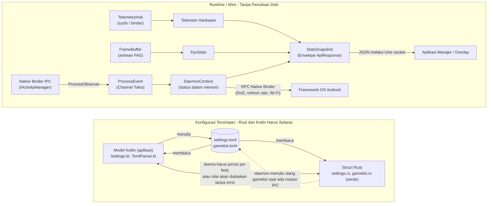

Auriya tidak menggunakan basis data eksternal — "entitas" utamanya berupa file konfigurasi, snapshot status dalam memori, serta payload data yang melintasi batas antara Rust dan Android. Halaman ini memetakan: apa masing-masing entitas tersebut, **di mana ia berada**, dan **ke mana arah sinkronisasinya**. Prinsip terpenting di sini adalah **keselarasan skema Rust ↔ Kotlin** untuk entitas konfigurasi — kedua sisi harus memiliki struktur field yang identik agar tidak ada data yang terabaikan secara diam-diam.

:::info Diverifikasi langsung terhadap kode sumber
Dilacak ke Auriya v2.2.0.
Rust: `src/core/config/`, `src/daemon/context.rs`, `src/core/stats/`, `src/core/telemetry/`, `src/platform/binder/`.
Kotlin: `android/shared/src/main/kotlin/dev/auriya/shared/model/` + `.../config/TomlParser.kt`.
:::

## Peta Entitas (Pemilik & Arah Sinkronisasi)



## Entitas Konfigurasi (Rust ↔ Kotlin)

Entitas ini memiliki **dua definisi otoritatif** — satu struct Rust (dikonsumsi oleh daemon) dan satu data class Kotlin (dibaca dan ditulis oleh aplikasi). Keduanya dihubungkan oleh file TOML.

### `Settings` ↔ `settings.toml` ↔ `Settings.kt`

| Grup | Rust (`settings.rs`) | Kotlin (`Settings.kt`) | Keterangan |
| --- | --- | --- | --- |
| `[daemon]` | `DaemonConfig { log_level, check_interval_ms, default_mode }` | `DaemonConfig(logLevel, checkIntervalMs, defaultMode)` | Selaras |
| `[cpu]` | `CpuConfig { default_governor }` | `CpuConfig(defaultGovernor)` | Selaras |
| `[dnd]` | `DndConfig { default_enable }` | `DndConfig(defaultEnable)` | Selaras |
| `[fas]` | `FasConfig { enabled, default_mode, thermal_threshold, poll_interval_ms, target_fps }` | `FasConfig(enabled, defaultMode, thermalThreshold, pollIntervalMs, targetFps)` | Selaras (kelima nilai) |
| `[dynamic_governor]` | `DynamicGovernorConfig { enabled, cv_threshold, debounce_frames }` | `DynamicGovernorConfig(enabled, cvThreshold, debounceFrames)` | Selaras |
| `[modes.*]` | `HashMap<String, FasMode { margin, thermal_threshold }>` | `Map<String, FasMode(margin, thermalThreshold)>` | Selaras |

Makna lengkap setiap kunci konfigurasi dapat dilihat di [Referensi settings](/id/reference/settings/).

### `GameProfile` ↔ `[[game]]` ↔ Kotlin

| Field | Tipe Data | Wajib? | Keterangan |
| --- | --- | --- | --- |
| `package` | string | Ya | Kunci whitelist |
| `cpu_governor` | string | Ya | |
| `enable_dnd` | bool | Ya | |
| `target_fps` | int **atau** int[] | — | Deserializer khusus (`TargetFpsConfig`) |
| `refresh_rate` | int | — | |
| `mode` | string | — | `powersave`/`balance`/`performance`/`fast` |
| `ceiling` | string | — | |

Rincian lengkap: [Referensi gamelist](/id/reference/gamelist/).

:::warning Aturan Sinkronisasi Skema
Parser Rust tidak mengaktifkan `#[serde(deny_unknown_fields)]`. Jika field baru hanya ditambahkan pada satu sisi:
- Field ada di TOML tapi tidak ada di struct Rust $\rightarrow$ **diabaikan secara diam-diam** saat dimuat.
- Field ditulis oleh aplikasi tapi tidak dibaca daemon $\rightarrow$ **konfigurasi mati** (berhasil diparse, tanpa efek nyata).

Oleh karena itu, penambahan setelan baru memerlukan pembaruan di 3 tempat: struct Rust, default TOML, dan model Kotlin + `TomlParser`. Pengaturan yang hanya digunakan oleh UI (misalnya sakelar auto-record) disimpan di DataStore Preferences aplikasi, **bukan** di `gamelist.toml`.
:::

## Entitas Runtime / Wire (Tanpa Penyimpanan Disk)

Entitas ini bersifat transien — dihitung setiap tick atau setiap ada permintaan, dan tidak pernah ditulis ke media penyimpanan disk.

### `ProcessEvent` (Native Binder $\rightarrow$ Daemon)

`src/daemon/pipeline.rs`. Didistribusikan secara asinkron dari `ProcessObserver` (`src/platform/binder/observer.rs`) atau `PidTracker` (`src/core/session/tracker.rs`) melalui channel bounded Tokio mpsc.

| Varian | Payload | Asal Usul |
| --- | --- | --- |
| `ForegroundChanged` | `{ pid: i32, pkg: String }` | Callback `IProcessObserver.onForegroundActivitiesChanged` |
| `PidExited` | `{ pid: i32 }` | Thread watcher `pidfd_open` yang menunggu di syscall `poll()` |

### `DaemonContext` (Status Dalam Memori)

`src/daemon/context.rs`. Wadah status terpusat yang thread-safe dan dibagikan antara tugas pipeline Tokio dan handler IPC socket Unix. Menyimpan:
- Flag atomic (`enabled`)
- Status profil aktif dan override manual (`override_foreground`, `active_profile`)
- Pelacak foreground (`current_pkg`, `current_pid`, `is_game`)
- Referensi pengontrol (controller FAS, klien Binder, Gamelist, Settings, Logger)

### `ApiResponse<T>` & `StatsSnapshot` (`GET_STATS` / `STREAM_STATS`)

`src/core/stats/snapshot.rs`. Disusun saat ada permintaan atau streaming kontinu dari `DaemonContext` + `TelemetryHub` + `FrameBuffer`. Dibungkus dalam envelope standar `ApiResponse<StatsSnapshot>`:

```json
{
  "status": "ok",
  "data": { "daemon": {...}, "binder": {...}, "fps": {...}, ... }
}
```

Aplikasi mendecode skema ini secara langsung untuk merender kartu tampilan metrik dan floating HUD. Skema lengkap ada di [API Stats](/id/reference/stats-api/).

## Ikhtisar Siklus Hidup Entitas

| Entitas | Dibuat Oleh | Lokasi Penyimpanan | Dibaca Oleh | Disimpan Permanen? |
| --- | --- | --- | --- | --- |
| `Settings` / `GameProfile` | Aplikasi (atau default installer) | TOML di file konfigurasi | Daemon (saat startup/watch) | Ya (file) |
| `ProcessEvent` | Native Binder / pidfd | Channel Tokio | Pipeline daemon | Tidak (aliran di RAM) |
| `DaemonContext` | Saat daemon boot | RAM | Pipeline & handler IPC | Tidak (hanya di RAM) |
| `StatsSnapshot` | Handler IPC | RAM $\rightarrow$ JSON socket | Aplikasi manajer / HUD | Tidak (per permintaan) |
| `ApiResponse<T>` | Handler IPC | RAM $\rightarrow$ wire | Aplikasi / CLI | Tidak (envelope wire) |
