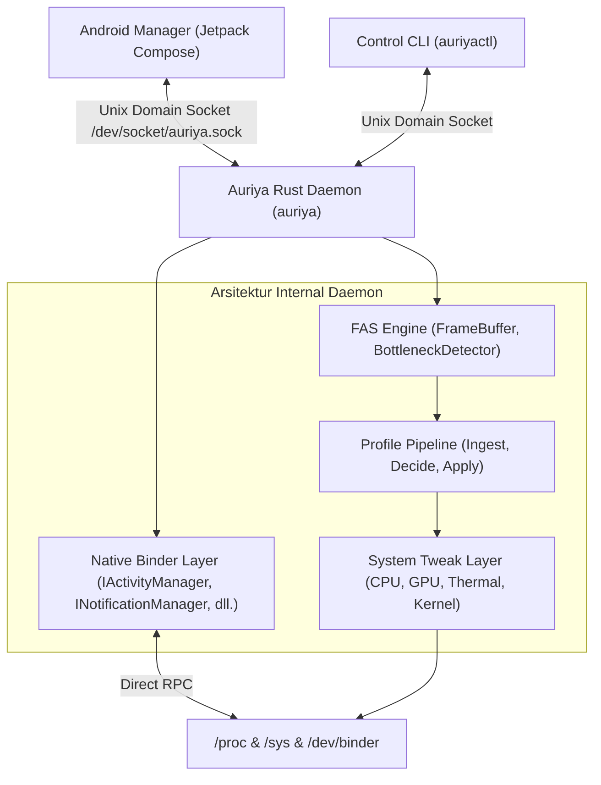
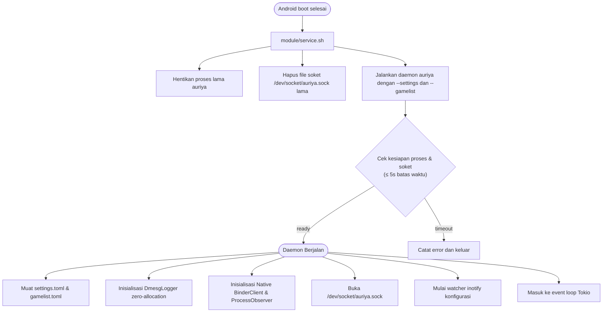
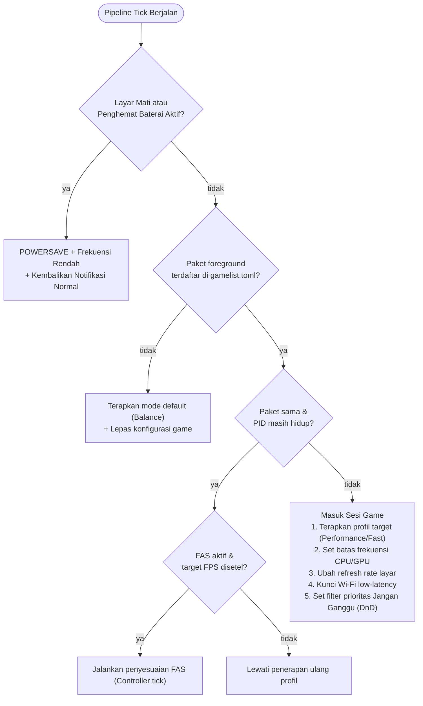

Auriya adalah sistem optimasi performa Android berbasis root yang terdiri dari dua bidang runtime utama: aplikasi manager modern berbasis Jetpack Compose dan daemon Rust `aarch64`. Daemon berkomunikasi langsung dengan antarmuka kernel (`/proc`, `/sys`) serta layanan sistem Android via **Native Binder IPC** (`rsbinder`), menghasilkan eksekusi scheduling real-time dan aliran telemetri instan tanpa I/O disk.

Aplikasi manager mengelola konfigurasi pengguna, tampilan overlay HUD interaktif, dan grafik benchmark. Daemon Rust mengelola pemantauan sistem jangka panjang, penjadwalan frame-aware, telemetri real-time, dan modulasi hardware. Biner CLI `auriyactl` menyediakan antarmuka terminal untuk kontrol dan automasi.

## Alur Eksekusi Biner

Modul yang terpasang tidak menjalankan daemon melalui aplikasi Android. Saat boot, script `module/service.sh` menunggu sinyal Android `sys.boot_completed`, menghentikan sisa proses daemon lama, menghapus file soket lama, dan mengeksekusi `/data/adb/modules/auriya/system/bin/auriya` dengan path konfigurasi settings dan gamelist. Log output dicatat langsung ke file `/data/adb/auriya/auriya.log` melalui engine logger dmesg zero-allocation.

## Siklus Pipeline Terstruktur

Event loop daemon dijalankan oleh runtime Tokio single-thread dengan pemisahan tahapan pipeline `ingest -> decide -> apply -> fas_tick`:

| Sumber Event | Hasil Eksekusi |
| :--- | :--- |
| **Callback ProcessObserver** | `IActivityManager` mendeteksi perpindahan aplikasi ke foreground (`onForegroundActivitiesChanged`); evaluasi profil dilakukan seketika tanpa polling. |
| **Timer Tick Berkala** | 500 ms saat sesi game aktif; 5 detik pada desktop normal (Balance); 10 detik saat layar mati (`IPowerManager.isInteractive() == false`). |
| **Inotify Settings / Gamelist** | Konfigurasi dimuat ulang secara otomatis saat file TOML disimpan; aturan profil dan governor diperbarui langsung. |
| **Request Unix Domain Socket** | Perintah client (`GET_STATS`, `SET_PROFILE`, `INJECT_APP`) diproses dan dibalas dengan amplop JSON terstandarisasi. |
| **SIGINT / SIGTERM** | Shutdown aman: melepas lock hardware, mereset limit frekuensi, memutus observer, dan menutup soket. |

## Alur Pengambilan Keputusan Profil

Pipeline profil mengevaluasi kondisi sistem dan identitas aplikasi secara berurutan:

### Mode Profil Statis

Profil diterapkan berdasarkan definisi pada [`src/core/profile/`](https://github.com/pavelc4/auriya/blob/main/src/core/profile):

| Profil | Aksi |
| :--- | :--- |
| **Fast** | Responsivitas maksimal: governor agresif, aktifkan CPU boost, nyalakan semua core CPU, optimasi vendor, devfreq GPU performa tinggi, optimasi antrean memori/IO, dan afinitas proses game. |
| **Performance** | Gaming seimbang: governor performa, aktifkan CPU boost, optimasi Snapdragon/MediaTek, devfreq GPU mode performa, dan tuning latensi scheduler. |
| **Balance** | Kondisi sistem normal: governor seimbang hemat daya, matikan CPU boost, devfreq GPU seimbang, kembalikan nilai default kernel memori dan storage. |
| **Powersave** | Penghematan baterai: governor `powersave`, turunkan batas frekuensi maksimal, batasi GPU, dan perlambat tick scheduler background. |

### Modulasi Dinamis FAS

Saat berada dalam game dengan Frame-Aware Scheduling (FAS) aktif, `FasController` secara kontinu menghitung penyesuaian PID demi menjaga kestabilan frame rate tanpa memicu thermal throttle:

| Aksi FAS | Efek yang Diterapkan |
| :--- | :--- |
| **BoostGpu** | Menaikkan level frekuensi GPU devfreq tanpa mengubah CPU. |
| **BoostCpu** | Menaikkan frekuensi cluster CPU dan afinitas proses tanpa menaikkan GPU. |
| **BoostBalanced** | Menaikkan frekuensi CPU dan GPU secara bersamaan. |
| **Maintain** | Frekuensi saat ini mencukupi target FPS; tidak ada penulisan ke hardware. |
| **Reduce** | Menurunkan frekuensi ke tingkat yang lebih hemat energi. |

## Batasan Bidang Runtime

- **Manager App (`android/app`)**: UI Jetpack Compose modern, tema M3 Monet dinamis, DataStore Preferences, model `@Immutable`, overlay HUD sub-pixel yang mulus, dan evaluasi riwayat sesi benchmark.
- **Shared Kotlin (`android/shared`)**: Model data bersama, serialisasi, dan eksekusi root shell helper.
- **Rust Daemon (`src/main.rs`, `src/daemon/`)**: Mesin event terpusat, orkestrasi pipeline (`ingest -> decide -> apply`), server Native Binder IPC, dan Unix domain socket handler.
- **Platform Layer (`src/platform/`)**: Client Native Binder (`IActivityManager`, `INotificationManager`, dll.), kontrol cluster CPU, devfreq GPU, dan pembaca multi-sensor thermal.
- **Core Domain Layer (`src/core/`)**: FAS (`FasController`, `BottleneckDetector`), state machine profil, parser TOML, dan engine logger zero-allocation.
- **Control CLI (`src/cli/`, `src/bin/auriyactl.rs`)**: Client baris perintah mandiri yang berkomunikasi via `/dev/socket/auriya.sock`.
