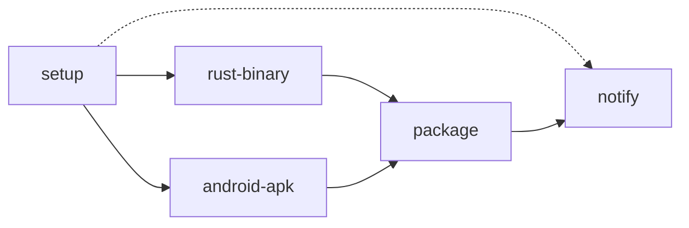
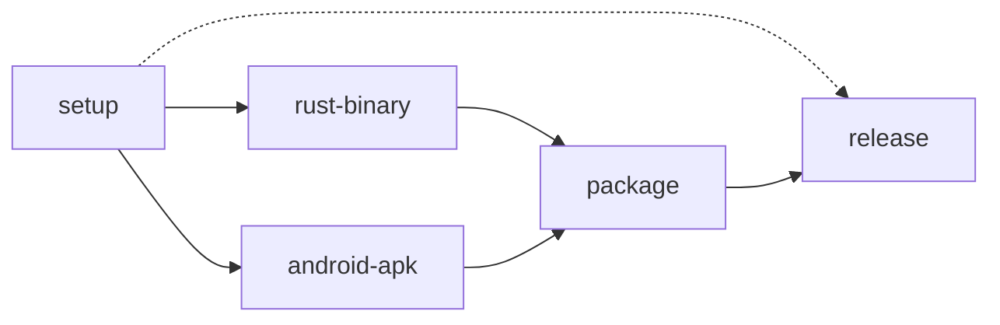

Diverifikasi langsung terhadap konfigurasi workflow CI/CD Auriya di repositori GitHub.

## Daftar Workflow

| File | Pemicu (Trigger) |
| --- | --- |
| `.github/workflows/build.yml` | `workflow_dispatch` (manual saja). |
| `.github/workflows/release.yml` | Push tag yang cocok dengan `v*`, atau `workflow_dispatch`. |

Tidak ada workflow untuk `pull_request`, push branch langsung, jadwal rutin (cron), atau matrix build. File `.github/dependabot.yml` mengotomatisasi pembaruan dependensi mingguan di empat ekosistem: Cargo (`/`), Gradle (`/android`), GitHub Actions (`/`), dan aksi komposit (`/.github/actions/setup-tools`).

## Aksi Komposit Bersama (Shared Composite Actions)

### `setup-tools`

Setiap pemanggilan menjalankan urutan instalasi toolchain identik ([sumber](https://github.com/pavelc4/auriya/blob/main/.github/actions/setup-tools/action.yml)):

1. `actions/setup-java@v6`: Java 26 (Temurin).
2. `nttld/setup-ndk@v1.6.0`: Android NDK r29 ditambahkan ke `PATH` dan diekspor ke environment.
3. `dtolnay/rust-toolchain@nightly`: Rust nightly dengan target `aarch64-linux-android` dan komponen `rust-src`.
4. `rustup default nightly-x86_64-unknown-linux-gnu`.
5. `curl -sL <bpf-linker-v0.11.0.tar.zst> | tar --zstd -x -C "${HOME}/.cargo/bin"`.
6. `cargo install cargo-ndk --locked`.
7. `sudo apt-get update && sudo apt-get install -y p7zip-full zstd`.

### `package-module`

Aksi komposit ini mengemas seluruh komponen modul ke dalam arsip ZIP flashable ([sumber](https://github.com/pavelc4/auriya/blob/main/.github/actions/package-module/action.yml)):

1. Membuat direktori staging `build/release/module` dan menyalin seluruh isi folder `module/*`.
2. Menyalin konfigurasi root `settings.toml` dan `gamelist.toml` ke staging modul.
3. Menyalin `module/system` jika tersedia.
4. Mencari APK aplikasi manager yang diunduh dari artefak build (`app-arm64-v8a-release.apk` atau fallback `*-arm64-v8a-*.apk`) dan menyalinnya ke `libs/app/auriya-app.apk`.
5. Memverifikasi ketersediaan biner daemon `target/aarch64-linux-android/release/auriya`; jika tidak ada, proses berhenti dengan exit code `1`. Biner CLI `auriyactl` disalin jika ada.
6. Menyalin biner ke `libs/aarch64/` dan membuat checksum internal `sha256sum * > checksums.sha256`.
7. Membaca `VERSION` dari `Cargo.toml`, `COMMIT_HASH` dari `git rev-parse --short HEAD`, dan `VERSION_CODE` dari `git rev-list --count HEAD`.
8. Memperbarui metadata `module.prop`, menghapus file placeholder, dan mengompres seluruh direktori staging menggunakan 7-Zip kompresi maksimal (`7z a -tzip -mm=Deflate -mx=9 -mfb=258 -mpass=15`).
9. Membuat file checksum SHA-256 untuk arsip ZIP yang dihasilkan melalui `sha256sum "$ZIP_NAME" > "$SHA_NAME"`.
10. Mengekspor output `$GITHUB_OUTPUT`: `zip_name`, `sha_name`, `version`, dan `version_code`.

Format nama berkas: `auriya-<versi>-<jumlah commit>-<short SHA>-<build_type>.zip` dan `.sha256`.

### `telegram-notify`

Mengirim notifikasi progres atau status rilis ke bot Telegram ([sumber](https://github.com/pavelc4/auriya/blob/main/.github/actions/telegram-notify/action.yml)):
- `start`: Mengirim pesan awal saat pipeline dimulai dan menyimpan ID pesan untuk dihapus nanti.
- `complete`: Mengunggah berkas ZIP modul beserta caption rilis ke Telegram dan menghapus pesan start.
- `failure`: Mengirim pesan kegagalan build/rilis jika terjadi error pada pipeline.

## Alur Kerja `build.yml`

**Pemicu:** `workflow_dispatch` (manual saja). Izin workflow adalah `contents: read` ([sumber](https://github.com/pavelc4/auriya/blob/main/.github/workflows/build.yml)).

### Graf Ketergantungan Job (DAG)



`rust-binary` dan `android-apk` berjalan secara paralel setelah `setup` selesai. Job `package` membutuhkan kedua job build tersebut. Job `notify` mendeklarasikan `needs: [setup, package]` dengan kondisi `if: !cancelled()`.

| Job | Runner | Kebutuhan (Needs) | Tujuan |
| --- | --- | --- | --- |
| `setup` | `ubuntu-latest` | none | Notifikasi start, konfigurasi kredensial Git, verifikasi instalasi tools bersama |
| `rust-binary` | `ubuntu-latest` | `setup` | Kompilasi silang, stripping, dan checksum biner Rust arm64 (`auriya`, `auriyactl`) |
| `android-apk` | `ubuntu-latest` | `setup` | Checkout keystore privat dan build APK manager bertanda tangan (`:app:assembleRelease`) |
| `package` | `ubuntu-latest` | `rust-binary`, `android-apk` | Unduh artefak dan bangun arsip ZIP modul serta file `.sha256` |
| `notify` | `ubuntu-latest` | `setup`, `package` | Mengirim berkas ZIP atau notifikasi kegagalan ke Telegram |

### Rincian Langkah per Job (`build.yml`)

#### `setup`
1. Checkout repositori dengan `fetch-depth: 0` (riwayat penuh).
2. Jika token bot Telegram tersedia, kirim notifikasi `type: start` dan simpan ID pesan.
3. Konfigurasi kredensial Git untuk dependensi privat.
4. Jalankan aksi komposit `setup-tools`.

#### `rust-binary`
1. Checkout kode sumber.
2. Jalankan `setup-tools` dan konfigurasi cache Cargo (`~/.cargo/registry`, `~/.cargo/git`).
3. Set path NDK pada `.cargo/config.toml`.
4. Kompilasi biner release via `cargo ndk -t aarch64-linux-android --platform 26 -- build --release --bin auriya --bin auriyactl`.
5. Strip simbol biner menggunakan NDK `llvm-strip` (atau host `strip` jika tidak ada).
6. Buat checksum `.sha256` untuk masing-masing biner.
7. Unggah artefak `rust-binary` dari direktori `target/aarch64-linux-android/release/auriya*`.

#### `android-apk`
1. Checkout kode sumber dan jalankan `setup-tools`.
2. Checkout repositori keystore privat `pavelc4/keystores` ke `keystores-private` menggunakan secret `KEYSTORES_SSH_KEY`.
3. Buat file `android/signing.properties` dari secrets.
4. Masuk ke direktori `android/`, ubah izin eksekusi `chmod +x gradlew`, dan jalankan `./gradlew :app:assembleRelease`.
5. Unggah artefak `android-apks` dari `android/app/build/outputs/apk/release/*.apk`.

#### `package`
1. Checkout kode sumber.
2. Unduh artefak `rust-binary` ke `target/aarch64-linux-android/release/`.
3. Unduh artefak `android-apks` ke root direktori kerja.
4. Jalankan `package-module` dengan parameter `build_type: debug`.
5. Unggah artefak `auriya-aarch64` berisi berkas `build/release/*.zip` dan `build/release/*.sha256` dengan `compression-level: 0`.

#### `notify`
1. Unduh artefak `auriya-aarch64` jika package berhasil.
2. Panggil `telegram-notify` dengan `type: complete` (menyertakan file ZIP) atau `type: failure`.

## Alur Kerja `release.yml`

**Pemicu:** Push tag baru yang diawali `v*` (misalnya `v2.2.0`), atau melalui `workflow_dispatch` manual. Izin workflow adalah `contents: write` ([sumber](https://github.com/pavelc4/auriya/blob/main/.github/workflows/release.yml)).

### Graf Ketergantungan Job (DAG)



Empat job pertama menjalankan perintah yang sama dengan `build.yml`, tetapi `package-module` menerima parameter `build_type: release`.

| Job | Runner | Kebutuhan (Needs) | Tujuan |
| --- | --- | --- | --- |
| `setup` | `ubuntu-latest` | none | Notifikasi start, konfigurasi kredensial, instalasi toolchain |
| `rust-binary` | `ubuntu-latest` | `setup` | Build/strip/checksum biner Rust arm64 |
| `android-apk` | `ubuntu-latest` | `setup` | Build APK manager rilis bertanda tangan (`:app:assembleRelease`) |
| `package` | `ubuntu-latest` | kedua job build | Bangun berkas ZIP modul bertipe release dan checksum SHA-256 |
| `release` | `ubuntu-latest` | `setup`, `package` | Publikasikan GitHub Release (ZIP + SHA256), perbarui `update.json`, notifikasi Telegram |

### Rincian Job `release`

1. Checkout riwayat lengkap repositori (`fetch-depth: 0`) dan unduh artefak `auriya-aarch64` ke `build/release/`.
2. **Resolusi Tag & Catatan Rilis**: Menentukan tag rilis (dari nama tag git atau sintesis `v<VERSION>`). Mengekstrak bagian versi teratas dari `CHANGELOG.md` menggunakan `awk '/^## /{if(p)exit;p=1;next} p' CHANGELOG.md > build/release/RELEASE_NOTES.md`.
3. **Publikasi GitHub Release**: Menggunakan `softprops/action-gh-release@v3` untuk membuat rilis baru atau memperbarui rilis yang ada, memasang bodi rilis dari `build/release/RELEASE_NOTES.md`, menandai rilis sebagai rilis terbaru (`make_latest: true`), dan mengunggah aset rilis berupa file ZIP (`auriya-*-release.zip`) dan file checksum SHA256 (`*.sha256`).
4. **Pembaruan `update.json`**: Menimpa file `update.json` dengan informasi versi, versionCode, tautan unduhan aset rilis, dan tautan raw changelog. Mengonfigurasi identitas Git bot, melakukan commit, menjalankan `git pull --rebase origin main`, lalu melakukan push langsung ke branch `main`.
5. **Notifikasi Telegram**: Mengirim dokumen ZIP modul ke obrolan Telegram dengan tautan rilis GitHub dan changelog.

## Spesifikasi Katalog KernelSU Modules (`module.yaml`)

Auriya menerbitkan metadata modulnya ke katalog resmi [KernelSU-Modules](https://github.com/KernelSU-Modules) melalui berkas manifes `module.yaml` di root repositori ([sumber](https://github.com/pavelc4/auriya/blob/main/module.yaml)):

```yaml
# yaml-language-server: $schema=https://raw.githubusercontent.com/KernelSU-Modules/tools/main/schemas/module.schema.json
schemaVersion: 1
id: auriya
name: Auriya
summary: Yet Another Android Performance Optimizer
description: README.md
icon: doc/asset/icon.png
license: GPL-3.0
homepage: https://github.com/pavelc4/auriya
support: https://github.com/pavelc4/auriya/issues
authors:
  - name: Pavelc4
    url: https://github.com/pavelc4
tags:
  - performance
  - gaming
  - optimizer
  - telemetry
  - system
compatibility:
  androidMinApi: 26
  architectures:
    - arm64-v8a
release:
  assetPattern: "auriya-*-release.zip"
```

### Validasi Skema & Batasan Katalog

1. **Validasi Skema**: Berkas manifes divalidasi langsung terhadap skema kanonikal `https://raw.githubusercontent.com/KernelSU-Modules/tools/main/schemas/module.schema.json`.
2. **Pola Aset Rilis (`assetPattern`)**: Dikonfigurasi ke `"auriya-*-release.zip"`. Bot katalog otomatis mendeteksi aset rilis GitHub yang cocok dengan pola ini, mengekstrak `module.prop`, dan memverifikasi kompatibilitas.
3. **Kompatibilitas Sistem**: API Android minimum 26 (Android 8.0 Oreo) dan arsitektur `arm64-v8a`. Sistem 32-bit atau Android di bawah API 26 secara otomatis ditolak.

## Checklist Reproduksi Lokal

Target kompilasi tunggal yang didukung adalah `aarch64-linux-android`, Android API 26, Rust release mode (`--release`), dan Gradle `:app:assembleRelease`. Layanan latar belakang companion Android (`service`) telah dihilangkan secara menyeluruh demi komunikasi Native Binder IPC tanpa penulisan disk.

Perlu dicatat bahwa job `package` pada GitHub Actions menggunakan checkout dangkal (shallow checkout secara default). Dalam lingkungan lokal, jika membutuhkan nilai `versionCode` yang identik dengan jumlah total commit di remote, jalankan `git fetch --unshallow` sebelum menjalankan skrip pemaketan modul.
