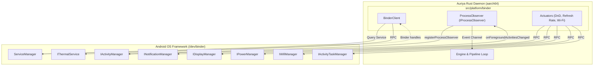
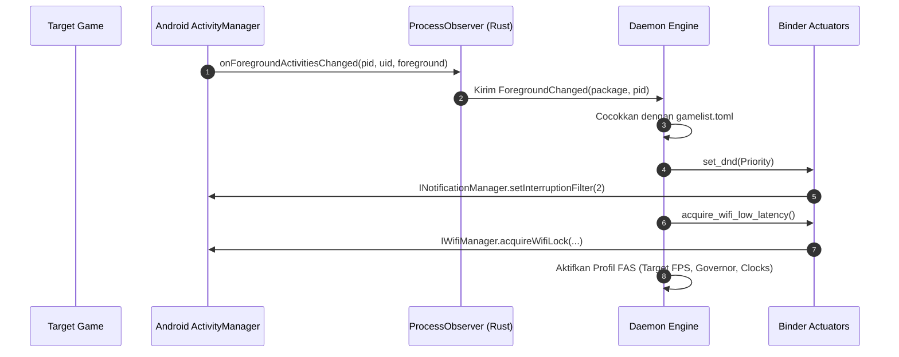

Auriya berkomunikasi langsung dengan framework sistem Android melalui **Native Binder IPC**. Tanpa bergantung pada proses perantara, aplikasi pendamping (companion), atau polling file di disk, daemon Rust aarch64 langsung berinteraksi dengan driver `/dev/binder` melalui `rsbinder` pada tingkat sistem operasi secara instan dan tanpa I/O disk.

:::info Diverifikasi terhadap sumber
`src/platform/binder/` — [`client.rs`](https://github.com/pavelc4/auriya/blob/main/src/platform/binder/client.rs), [`observer.rs`](https://github.com/pavelc4/auriya/blob/main/src/platform/binder/observer.rs), [`actuators.rs`](https://github.com/pavelc4/auriya/blob/main/src/platform/binder/actuators.rs), [`services.rs`](https://github.com/pavelc4/auriya/blob/main/src/platform/binder/services.rs).
:::

## Evolusi: Mengapa Companion Dihentikan

Pada versi awal, biner native Linux yang berjalan sebagai root tidak dapat dengan mudah memanggil API framework Java/AIDL tanpa proses perantara. Arsitektur lama memanfaatkan service companion Java berbasis `app_process` (`AuriyaSysMon`) yang memeriksa status framework dan bertukar perintah lewat penulisan file disk (`auriya_cmd` dan `system_status`).

Pendekatan tersebut memiliki banyak kelemahan:

| Parameter | Java Companion Lama | Native Binder IPC (v2.2.0+) |
| :--- | :--- | :--- |
| **Beban Memori (RAM)** | ~25 MB RSS (Instance JVM Android) | **~0 MB tambahan** (Terintegrasi di daemon, total ~5.5 MB RSS) |
| **Media Komunikasi** | File disk (`/data/adb/.config/auriya/`) | **Zero-disk IPC** (Driver Binder `/dev/binder`) |
| **Latensi Event** | Interval polling (250ms - 1000ms) | **Sub-milidetik** (Callback stream langsung) |
| **Keausan Flash Storage** | Penulisan file terus-menerus pada 1-4Hz | **Nol penulisan disk (Zero wear)** |
| **Manajemen Proses** | Watchdog `app_process` & file lock rentan crash | **Biner daemon tunggal terpadu** |

Pada pembaruan v2.2.0, service companion Java resmi dihentikan sepenuhnya. Daemon kini berkomunikasi langsung ke `servicemanager` bawaan Android.

## Diagram Arsitektur

## Layanan Sistem Android yang Diintegrasikan

### 1. `IActivityManager` (Sensor Lifecycle Foreground)
- **Interface AIDL**: `android.app.IActivityManager`
- **Implementasi**: [`ProcessObserver`](https://github.com/pavelc4/auriya/blob/main/src/platform/binder/observer.rs) mengimplementasikan `IProcessObserver` secara native di Rust.
- **Alur Kerja**:
  1. Daemon mendaftarkan diri lewat `registerProcessObserver(observer)`.
  2. Framework Android otomatis mengirim callback ke daemon saat aplikasi berpindah ke layar depan (`onForegroundActivitiesChanged`) atau saat proses mati (`onProcessDied`).
  3. Event diteruskan langsung ke channel asynchronous Tokio (`event_tx`), memicu peralihan profil dan optimasi game seketika tanpa perlu polling berkala ke procfs.

### 2. `INotificationManager` (Aktuator Jangan Ganggu / DnD)
- **Interface AIDL**: `android.app.INotificationManager`
- **Implementasi**: [`set_dnd`](https://github.com/pavelc4/auriya/blob/main/src/platform/binder/actuators.rs) memanggil RPC `setInterruptionFilter`.
- **Mode**:
  - `InterruptionFilter::Priority` (Nilai `2`): Memblokir notifikasi masuk saat game sedang berjalan.
  - `InterruptionFilter::All` (Nilai `1`): Mengembalikan notifikasi normal saat keluar dari game.

### 3. `IDisplayManager` (Refresh Rate & Mode Layar)
- **Interface AIDL**: `android.hardware.display.IDisplayManager`
- **Fitur**:
  - Query daftar mode resolusi dan refresh rate layar yang didukung perangkat.
  - Mengubah refresh rate layar secara langsung dan mengembalikannya ke nilai awal saat keluar dari profil game.

### 4. `IPowerManager` (Deteksi Layar Interaktif)
- **Interface AIDL**: `android.os.IPowerManager`
- **Fitur**:
  - Memeriksa `isInteractive()` untuk mengetahui apakah layar sedang menyala.
  - Saat layar mati, daemon secara otomatis menurunkan frekuensi pengecekan internal untuk menghemat konsumsi daya baterai.

### 5. `IWifiManager` (Lock Wi-Fi Low-Latency)
- **Interface AIDL**: `android.net.wifi.IWifiManager`
- **Fitur**:
  - Mengaktifkan `acquireWifiLock` dengan mode `WIFI_MODE_FULL_LOW_LATENCY`.
  - Menonaktifkan mode hemat daya Wi-Fi agar transmisi paket data game online tetap stabil tanpa lonjakan ping.

### 6. `IActivityTaskManager` (Deteksi Window Floating & Multi-Window)
- **Interface AIDL**: `android.app.IActivityTaskManager`
- **Fitur**:
  - Memeriksa mode tampilan aplikasi (windowing mode).
  - Mendeteksi jika aplikasi berjalan dalam mode freeform, split-screen, atau floating window untuk menerapkan batas 30 FPS adaptif demi menghemat daya.

### 7. `IThermalService` (Monitoring Suhu Hybrid)
- **Interface AIDL**: `android.os.IThermalService`
- **Fitur**:
  - Membaca status suhu framework Android serta cooling devices yang terdaftar.
  - Dilengkapi sistem fallback dinamis ke zona sysfs multi-SoC (Snapdragon dan MediaTek).

## Urutan Eksekusi Event

