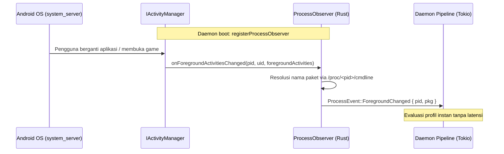

"Deteksi game" adalah mekanisme bagaimana daemon menentukan **paket mana yang sedang aktif di latar depan (foreground)**, apakah paket tersebut dikelola oleh Auriya (terdaftar di whitelist), dan apakah prosesnya masih hidup. Auriya menerima event perubahan aktivitas latar depan secara langsung dari framework Android via Native Binder IPC (`IProcessObserver`), memvalidasi identitas proses melalui `/proc/<pid>/cmdline`, dan melacak siklus hidupnya.

:::info Diverifikasi langsung terhadap kode sumber
Dilacak ke Auriya v2.2.0. File terkait:
- [`src/platform/binder/observer.rs`](file:///home/sineva/prjkt/rust/auriya/src/platform/binder/observer.rs) (Implementasi Native `IProcessObserver`)
- [`src/platform/procfs.rs`](file:///home/sineva/prjkt/rust/auriya/src/platform/procfs.rs) (Validasi PID dan nama paket)
- [`src/core/session/tracker.rs`](file:///home/sineva/prjkt/rust/auriya/src/core/session/tracker.rs) (Pelacakan keaktifan pidfd dan event keluar)
- [`src/daemon/pipeline.rs`](file:///home/sineva/prjkt/rust/auriya/src/daemon/pipeline.rs) (Alur pipeline Ingest $\rightarrow$ Decide $\rightarrow$ Apply $\rightarrow$ FAS)
:::

## Asal Usul Paket Foreground

Pada v2.2.0, Auriya mendaftarkan callback native `IProcessObserver` langsung ke service `IActivityManager` Android melalui Native Binder IPC (`src/platform/binder/observer.rs`).

Setiap kali framework sistem Android mengganti task yang sedang aktif, callback `onForegroundActivitiesChanged(pid, uid, foregroundActivities)` dipanggil. Observer langsung meresolusi nama proses melalui `procfs::verify_pid_package` dan mendistribusikan pesan `ProcessEvent::ForegroundChanged` melalui channel bounded Tokio mpsc langsung ke engine daemon.

Arsitektur berbasis event ini memberikan waktu reaksi instan dengan zero-latency tanpa perlu mem-polling file, menggunakan aplikasi APK perantara, ataupun menguras baterai.

Perintah IPC `INJECT <package>` memungkinkan override paket foreground secara manual untuk kebutuhan debugging; `CLEAR_INJECT` menghapus status override tersebut (lihat [Protokol IPC](/id/internals/ipc-protocol/#2-sakelar-status-toggles)).

## Whitelist Paket Game

Saat startup dan pada setiap perubahan file `gamelist.toml`, daemon membangun `HashSet` berisi nama-nama paket dari daftar game — yang disebut "whitelist". Suatu aplikasi dianggap sebagai "game" oleh Auriya jika dan hanya jika nama paketnya terdapat dalam set ini. Pencocokan bersifat **persis/exact** (tanpa wildcard); lihat [Referensi Gamelist](/id/reference/gamelist/).

## Validitas PID vs Verifikasi Paket

Dua pemeriksaan ringan di `src/platform/procfs.rs`:

| Fungsi | Pemeriksaan | Penggunaan |
| :--- | :--- | :--- |
| `is_pid_valid(pid)` | `pid > 0` **dan** direktori `/proc/<pid>` ada | Membuang referensi PID yang sudah mati secara cepat. |
| `verify_pid_package(pid, pkg)` | Membaca `/proc/<pid>/cmdline` dan mencocokkan dengan `pkg` | Memastikan PID tersebut benar-benar milik paket aplikasi yang diharapkan. |

`verify_pid_package` mencocokkan nama proses hingga pemisah `\0` atau `:`, dan juga menerima kecocokan substring sehingga **proses terisolasi** bernama `<pkg>:<suffix>` (pola umum di Android) tetap dikenali sebagai bagian dari paket tersebut.

## Pelacakan Keaktifan dan Deteksi Keluar Instan

Setelah PID game yang terdaftar di whitelist tervalidasi, daemon membuat instance `PidTracker` (`src/core/session/tracker.rs`) yang menjalankan dua fungsi:

1. **Pemeriksaan Cepat (Cheap Poll)** — `PidTracker::is_alive()` adalah pemeriksaan non-blocking yang digunakan oleh pipeline loop pada jalur cepat (fast path).
2. **Event Keluar Instan (Instant Exit Event)** — Thread latar belakang memblokir hingga proses target benar-benar mati, lalu mengirim event `ProcessEvent::PidExited`, sehingga daemon langsung mengevaluasi ulang status *seketika* tanpa menunggu jeda timer berikutnya.

Dua jalur kernel yang dipilih secara dinamis saat runtime:
- **`pidfd_open` (Linux $\ge$ 5.3)** — Pelacak membuka pidfd melalui syscall langsung (nomor `434` pada aarch64, `439` pada x86-64) dan menunggu di `poll()`. Tidak ada konsumsi CPU/wakeups hingga proses keluar.
- **Fallback `/proc`** — Pada kernel lama, watcher melakukan polling ke `/proc/<pid>` setiap **150 ms** (`POLL_INTERVAL_MS = 150`), dan `is_alive` memeriksa keberadaan file di `/proc/<pid>`.

Sebuah `eventfd` memungkinkan implementasi `Drop` membatalkan watcher yang sedang menunggu seketika saat daemon berhenti melacak (misalnya saat beralih game).

## Bagaimana Deteksi Mendorong Pipeline

Setiap tick mengevaluasi status paket dan PID (`src/daemon/pipeline.rs`):
- **Paket sama, PID masih hidup** $\rightarrow$ Jalur cepat (fast path): tweak statis *tidak* diterapkan ulang; hanya FAS yang menyesuaikan frekuensi dinamis.
- **Paket baru, atau PID lama telah keluar** $\rightarrow$ Evaluasi ulang profil secara penuh.
- **Paket terdaftar di whitelist dengan PID valid** $\rightarrow$ Memulai atau memperbarui sesi game (menerapkan tweak game, Wi-Fi low-latency lock, DnD, dan FAS controller).
- **Tidak ada di whitelist, PID tidak valid, atau layar mati** $\rightarrow$ Membersihkan status game dan menerapkan profil default.
