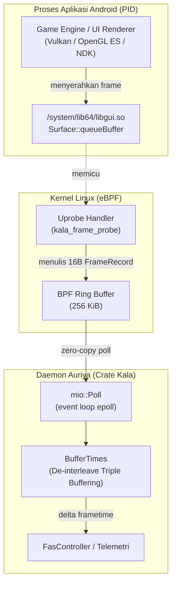

Kala ([`pavelc4/kala`](https://github.com/pavelc4/kala)) adalah pustaka pelacak waktu frame (frame time) aplikasi pada Android menggunakan kernel eBPF uprobe pada fungsi `Surface::queueBuffer` di `/system/lib64/libgui.so`. Auriya menggunakan Kala sebagai sumber data frame time untuk Frame-Aware Scheduling (FAS) dan pemantauan performa tanpa perlu injeksi pustaka ataupun modifikasi biner game.

Auriya memanfaatkan Kala sebagai fondasi telemetri utama untuk Frame-Aware Scheduling (FAS) dan pencatatan benchmark game.

## Arsitektur & Cara Kerja Kala



### 1. Probe Kernel eBPF (`ebpf/src/main.rs`)

Program kernel (`kala-ebpf-kernel`) dikompilasi dengan `#![no_std]` dan `#![no_main]` untuk target `bpfel-unknown-none`. Program ini memasang hook ke `Surface::queueBuffer`:

- **Ekstraksi Argumen**: Membaca `arg(1)` (`ANativeWindowBuffer* buffer`), yaitu pointer alamat memori unik dari back-buffer yang sedang diserahkan.
- **Timestamping Presisi**: Mengambil waktu perangkat keras monotonik melalui syscall `bpf_ktime_get_ns()`.
- **Ring Buffer Zero-Copy**: Menulis `FrameRecord` berukuran 16 byte ke ring buffer BPF sebesar 256 KiB (`RING_BUF`):

```rust
#[repr(C)]
pub struct FrameRecord {
    pub ktime_ns: u64, // Timestamp monotonik dalam nanodetik
    pub buffer: u64,   // Pointer ANativeWindowBuffer (kunci pembeda buffer)
}
```

Kapasitas ring buffer 256 KiB mampu menampung lonjakan ratusan frame tanpa kehilangan data saat daemon di userspace sempat ter-deschedule.

### 2. Ketahanan Simbol C++ Lintas Versi Android (`uprobe.rs`)

AOSP sering memodifikasi tanda tangan fungsi `Surface::queueBuffer` antar versi Android (Android 10 hingga 17 / API 37). Kala menangani hal ini melalui daftar fallback simbol terurut:

1. `_ZN7android7Surface16hook_queueBufferEP13ANativeWindowP19ANativeWindowBufferi`: Trampoline C-API `hook_queueBuffer`. Merupakan titik probe paling stabil di perangkat modern.
2. `_ZN7android7Surface19queueBufferInternalEP13ANativeWindowP19ANativeWindowBufferi`: Fungsi internal yang dipanggil oleh `hook_queueBuffer`.
3. `_ZN7android7Surface11queueBufferEP19ANativeWindowBufferi`: Simbol langsung legacy (AOSP $\le$ 10).
4. `_ZN7android7Surface11queueBufferEP19ANativeWindowBufferiPNS_24SurfaceQueueBufferOutputE`: Overload legacy dengan parameter output.
5. `_ZN7android7Surface11queueBufferEONS_2spINS_13GraphicBufferEEEiPNS_24SurfaceQueueBufferOutputE`: Overload modern berbasis smart-pointer `sp<GraphicBuffer>` (Android 12+).

Kala mencoba simbol-simbol tersebut secara berurutan dan mengaitkan simbol pertama yang berhasil.

### 3. De-interleaving Triple-Buffering & Heuristik (`tracker/mod.rs`)

Aplikasi Android menggunakan mekanisme double atau triple buffering yang menyebabkan event penyerahan buffer datang berselingan. Untuk mengekstrak interval waktu antar frame yang bersih:

- **Riwayat Per-Buffer**: Kala mengelompokkan event berdasarkan pointer buffer ke dalam `HashMap<u64, BufferHistory>`. Setiap buffer memiliki antrean riwayat statis hingga 144 entri (`PER_BUFFER_HISTORY = 144`).
- **Kalkulasi Delta**: Menghitung $\Delta t = \text{ktime}_{\text{sekarang}} - \text{last\_ktime}_{\text{buffer}}$ khusus untuk buffer yang sama.
- **Heuristik Buffer Aktif**: Mengidentifikasi back-buffer yang benar-benar tampil ke layar dengan memilih buffer yang memiliki riwayat terpanjang, lalu menyaring yang memiliki **total akumulasi durasi terkecil** ($\sum \Delta t$).
- **Zero Alokasi pada Kondisi Stabil**: Setelah buffer awal terdeteksi, logika pelacakan frame tidak melakukan alokasi memori heap sama sekali (`0 alloc/frame`).

### 4. Multiplexing & Polling Multi-Target (`lib.rs`)

`FrameProbe` dapat memantau beberapa proses (PID) secara bersamaan menggunakan satu engine `mio::Poll`:

- **Epoll Non-blocking**: File descriptor ring buffer setiap PID didaftarkan ke `mio::Interest::READABLE` menggunakan token `Token(pid as usize)`.
- **Pengurasan Antrean Adil (Fair Round-Robin Draining)**: Melalui antrean `pending: VecDeque<Pid>`, pemrosesan frame dibagi secara berimbang sehingga aplikasi dengan frame rate tinggi (misalnya 120 FPS) tidak membuat aplikasi lain (misalnya 60 FPS) kekurangan pembacaan event.
- **Telemetri Lengkap (`recv_with_stats`)**: Mengembalikan data `FrameEvent`:
  - `pid`: PID proses target.
  - `frametime`: Durasi frame terhitung (`Duration`).
  - `pump_latency_ns`: Latensi eksekusi pembacaan ring buffer di userspace ($\le 500$ ns).
  - `ring_records`: Jumlah baris record BPF mentah yang dikonsumsi per frame.
  - `burst_count`: Urutan frame yang diproses dalam siklus bangun epoll yang sama.

## Integrasi dengan Auriya

Di dalam daemon Auriya (`src/core/fas/source.rs` dan `src/core/stats/fps.rs`):

1. **Pengikatan Siklus Hidup Otomatis**: Saat game masuk ke latar depan, observer proses Native Binder memicu panggilan `probe.attach(pid)`.
2. **Pacing Dinamis (FAS)**: Nilai frametime yang diterima diolah oleh `FasController` untuk menghitung varians waktu frame ($CV$), mendeteksi bottleneck CPU/GPU, dan menggeser frekuensi governor.
3. **Pelepasan Bersih**: Ketika game ditutup (`ProcessEvent::PidExited`), panggilan `probe.detach(pid)` menghapus registrasi token epoll dan meng-unload program eBPF dari kernel. Jika eBPF tidak didukung kernel perangkat, sistem otomatis menggunakan sysfs sebagai fallback.

## Interaksi dengan RASP / Anti-Tamper & Blacklist Dinamis

Karena uprobe Linux menyuntikkan software breakpoint (`BRK #0x0004` pada ARM64) ke segmen `.text` pada `/system/lib64/libgui.so`, halaman memori tersebut berubah menjadi halaman anonim privat Copy-on-Write (COW).

Aplikasi dengan perlindungan Runtime Application Self-Protection (RASP) seperti DexGuard atau Promon SHIELD (pada aplikasi perbankan) mendeteksi segmen memori yang termodifikasi melalui `dl_iterate_phdr` dan sengaja menghentikan aplikasi (`RuntimeException: 229570587`).

Untuk mengatasi hal ini, Auriya mengimplementasikan mekanisme blacklist dinamis ([`blacklist.toml`](/id/reference/blacklist/)):
- Saat aplikasi di blacklist masuk ke foreground, Auriya secara proaktif melepas seluruh probe eBPF melalui `ebpf_detach_all()`, mengembalikan segmen memori ke kondisi bersih tanpa modifikasi.
- Pengukuran FPS otomatis beralih ke hardware sysfs display controller (Qualcomm DPU CRTC `measured_fps`).
- Saat pengguna keluar dari aplikasi blacklist, probe eBPF otomatis dipasang kembali untuk aplikasi reguler dan game.
