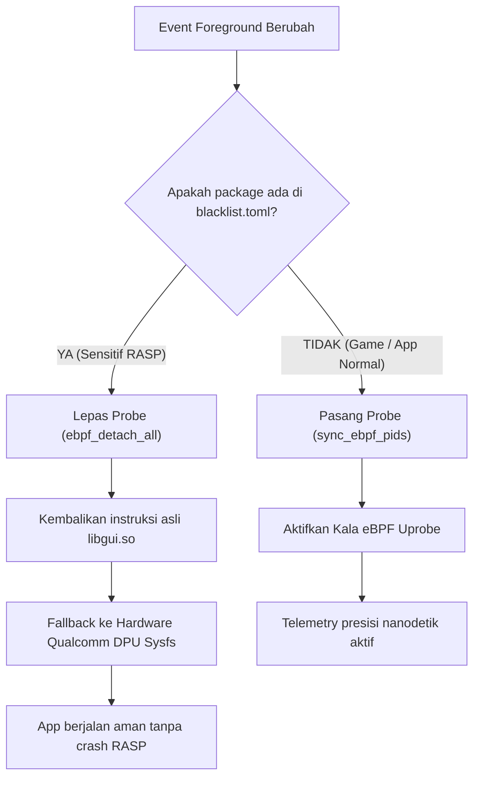

`blacklist.toml` adalah berkas konfigurasi Auriya yang mengatur daftar paket aplikasi yang **dikecualikan dari instrumentasi eBPF uprobe**. Konfigurasi ini dirancang untuk mencegah crash pada aplikasi perbankan atau aplikasi dengan perlindungan keamanan tinggi (RASP).

:::note Kebutuhan Pribadi & Catatan Penggunaan
Fitur ini diimplementasikan atas **kebutuhan pribadi** pengembang yang menggunakan aplikasi perbankan digital Indonesia (*blu by BCA Digital*, *BCA mobile*, *Livin' by Mandiri*, *BRImo*, dll) di perangkat sehari-hari. 

**Jika Anda tidak membutuhkan fitur ini dan tidak menggunakan aplikasi yang ada di daftar blacklist, silakan abaikan saja konfigurasi ini.** Konfigurasi default aman dan tidak akan mempengaruhi performa maupun optimasi game Anda.
:::

## Lokasi dan Kepemilikan Berkas

| Properti | Nilai | Sumber Kode |
| --- | --- | --- |
| Jalur Terinstal | `/data/adb/.config/auriya/blacklist.toml` | `src/core/config/path.rs` (`blacklist_path()`) |
| Format Data | TOML (`packages = [...]`) | `src/core/config/blacklist.rs` |
| Ditulis Oleh | Pengguna / Modul installer | `toml/blacklist.toml` |
| Dibaca Oleh | **Daemon Rust** saat startup dan otomatis reload saat berkas berubah | `src/daemon/watcher/config.rs` |

---

## Latar Belakang & Masalah Teknis (Root Cause)

### 1. Bagaimana Kala eBPF Bekerja
Auriya mengukur frame rate (FPS) dan frame time secara presisi tinggi menggunakan library eBPF **Kala**. Kala memasang probe **uprobe** (*user-space probe*) ke library grafis sistem Android:
```text
/system/lib64/libgui.so -> android::Surface::queueBuffer
```
Di level kernel Linux, uprobe bekerja dengan menyuntikkan instruksi software breakpoint ARM64:
- Opcode: `BRK #0x0004` (`0xd4200000`)
- Lokasi: Entry point fungsi `queueBuffer` pada segmen kode (`.text`) `libgui.so`.

Ketika fungsi tersebut dipanggil oleh aplikasi, kernel memicu trap breakpoint, mengeksekusi program eBPF Auriya untuk mencatat timestamp nanodetik ke BPF ring buffer, lalu melanjutkan eksekusi program asli.

### 2. Efek Copy-on-Write (COW) pada Memori
Di Linux, segmen kode (`.text`) dari shared library seperti `libgui.so` seharusnya berstatus *clean shared memory* (dibagi bersama oleh semua proses tanpa duplikasi memori fisik).

Namun, saat kernel memasang breakpoint uprobe khusus pada PID aplikasi target, kernel terpaksa membuat salinan halaman memori privat melalui mekanisme **Copy-on-Write (COW)**. Halaman kode tersebut kini berstatus **private dirty anonymous memory page**.

### 3. Deteksi Integritas oleh DexGuard RASP
Aplikasi perbankan modern (seperti *blu by BCA Digital* `com.bcadigital.blu`) dilengkapi dengan sistem proteksi **RASP** (*Runtime Application Self-Protection*) komersial seperti DexGuard.

Saat aplikasi dimulai, modul RASP memindai memori prosesnya sendiri:
1. Membaca header ELF di memori menggunakan fungsi POSIX `dl_iterate_phdr`.
2. Memeriksa permission dan flag halaman memori (`/proc/self/maps`).
3. Menghitung checksum segmen kode atau memeriksa apakah ada instruksi breakpoint (`BRK`).

Begitu DexGuard mendeteksi adanya dirty COW page atau breakpoint pada `libgui.so`, sistem RASP langsung menganggap aplikasi sedang di-hook, di-debug, atau dimanipulasi oleh alat peretas. Akibatnya, aplikasi langsung memicu crash terencana:
```text
FATAL EXCEPTION: main
Process: com.bcadigital.blu, PID: 12345
java.lang.RuntimeException: Unable to start activity ComponentInfo{com.bcadigital.blu/e.eG}:
java.lang.RuntimeException: 229570587
    at android.app.ActivityThread.performLaunchActivity(ActivityThread.java:4206)
    ...
```

---

## Solusi & Cara Kerja Blacklist di Auriya

Auriya menyelesaikan masalah ini di level daemon pipeline tanpa memerlukan modul hide terpisah:



### 1. Deteksi Dinamis & Pelepasan Probe Instan
Ketika aplikasi yang terdaftar di `blacklist.toml` masuk ke foreground:
- Daemon mengevaluasi package melalui fungsi `is_tamper_sensitive(pkg)`.
- Jika terdaftar, daemon segera mengeksekusi `ebpf_detach_all().await`.
- Kernel Linux langsung menghapus breakpoint dari `libgui.so`, sehingga memori aplikasi kembali bersih (*clean*).

### 2. Fallback Pengukuran Hardware Sysfs
Meskipun probe eBPF dilepas, Auriya tidak membiarkan status FPS kosong. Pipeline otomatis beralih ke pembacaan hardware sysfs display controller (misalnya Qualcomm DPU CRTC `measured_fps` di `/sys/class/drm/sde-crtc-0/measured_fps`). Dengan begitu, data FPS tetap terbaca tanpa menyentuh ruang memori aplikasi perbankan.

### 3. Pemasangan Ulang Otomatis (Auto Re-Attach)
Begitu pengguna keluar dari aplikasi blacklist (misalnya kembali ke Home launcher, membuka browser, atau membuka game):
- Daemon mendeteksi bahwa aplikasi aktif sekarang bukan blacklist.
- Daemon langsung memanggil `sync_ebpf_pids()` dan mengaitkan kembali (*re-attach*) probe uprobe ke kernel secara transparan tanpa perlu restart daemon.

---

## Format Berkas `blacklist.toml`

Berkas `/data/adb/.config/auriya/blacklist.toml` menggunakan struktur array string sederhana:

```toml
# ==============================================================================
# Auriya Tamper-Sensitive / Blacklist Packages Configuration
# ==============================================================================
# Packages listed here will NOT be attached by eBPF uprobes on libgui.so.
# Instead, the daemon will fallback to hardware sysfs FPS calculation.
# This prevents RASP (DexGuard, Promon, etc.) tamper-detection crashes.
# ==============================================================================

packages = [
  "com.bcadigital.blu",
  "com.bca",
  "id.co.bankmandiri.livin",
  "id.co.bri.brimo",
  "id.co.bni.newmobile",
  "com.smbc.id.wondr",
  "id.co.cimbniaga.octomobile",
  "com.bankbtngn.mobilebanking",
  "com.btpn.dc",
  "id.dana",
  "com.ovo.consumer",
  "com.linkaja",
  "com.seabank.mobile",
  "id.jago.app",
  "com.bankneo.neobank",
  "com.nobubank.nobuepay",
  "id.co.maybank.m2u",
  "com.danamon.danamononline",
  "com.google.android.gms",
  "com.android.vending",
  "com.google.android.gsf",
  "com.android.systemui",
]
```

### Menambah Paket Baru
Jika Anda memiliki aplikasi perbankan, finansial, atau aplikasi perusahaan lain yang mendadak crash saat dibuka:
1. Temukan nama package aplikasi tersebut (misal: `com.contoh.bank`).
2. Tambahkan string package ke dalam array `packages` di `/data/adb/.config/auriya/blacklist.toml`.
3. Simpan berkas. Inotify file watcher Auriya akan langsung memuat ulang daftar paket secara otomatis tanpa perlu restart daemon.
