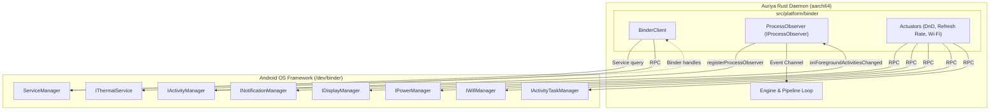
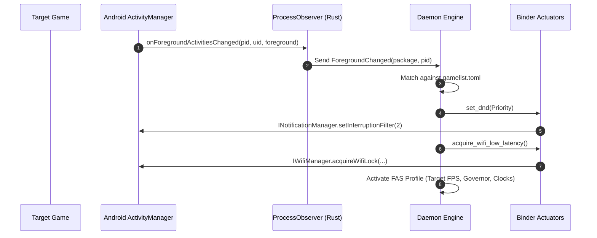

Auriya communicates directly with the Android OS framework through **Native Binder IPC**. Rather than relying on helper processes, companion apps, or disk polling, the aarch64 Rust daemon directly talks to Android's `/dev/binder` driver via `rsbinder`, interacting with Android system services at native speed with zero disk I/O.

:::info Verified against source
`src/platform/binder/` — [`client.rs`](https://github.com/pavelc4/auriya/blob/main/src/platform/binder/client.rs), [`observer.rs`](https://github.com/pavelc4/auriya/blob/main/src/platform/binder/observer.rs), [`actuators.rs`](https://github.com/pavelc4/auriya/blob/main/src/platform/binder/actuators.rs), [`services.rs`](https://github.com/pavelc4/auriya/blob/main/src/platform/binder/services.rs).
:::

## Evolution: Why Companion was Decommissioned

In legacy releases, native Linux binaries running as root were unable to easily call Java/AIDL Android framework APIs without an intermediate process. Early versions used an `app_process` Java companion service (`AuriyaSysMon`) that polled framework state and exchanged commands via file writes on disk (`auriya_cmd` and `system_status`).

That approach had significant drawbacks:

| Metric | Legacy Java Companion | Native Binder IPC (v2.2.0+) |
| :--- | :--- | :--- |
| **Runtime Overhead** | ~25 MB RSS (Android JVM instance) | **~0 MB extra** (Embedded in daemon, ~5.5 MB total RSS) |
| **Communication Medium** | Disk files (`/data/adb/.config/auriya/`) | **Zero-disk IPC** (Native Binder driver `/dev/binder`) |
| **Event Latency** | Polling intervals (250ms - 1000ms) | **Sub-millisecond** (Direct callback stream) |
| **Flash Memory Wear** | Continuous disk writes at 1-4Hz | **Zero flash writes** |
| **Process Management** | Fragile `app_process` watchdog & locks | **Single unified daemon binary** |

In v2.2.0, the Java companion was completely decommissioned. The daemon now interacts directly with Android's `servicemanager`.

## Architecture Overview

## Integrated Android System Services

### 1. `IActivityManager` (Foreground Lifecycle Sensor)
- **AIDL Interface**: `android.app.IActivityManager`
- **Implementation**: [`ProcessObserver`](https://github.com/pavelc4/auriya/blob/main/src/platform/binder/observer.rs) implements `IProcessObserver` natively in Rust.
- **Workflow**:
  1. The daemon invokes `registerProcessObserver(observer)`.
  2. The Android framework notifies the daemon when an app moves to the foreground (`onForegroundActivitiesChanged`) or dies (`onProcessDied`).
  3. Events are routed directly into an asynchronous Tokio channel (`event_tx`), instantly triggering profile switching and game optimizations without procfs polling.

### 2. `INotificationManager` (Do Not Disturb Actuator)
- **AIDL Interface**: `android.app.INotificationManager`
- **Implementation**: [`set_dnd`](https://github.com/pavelc4/auriya/blob/main/src/platform/binder/actuators.rs) calls `setInterruptionFilter`.
- **Modes**:
  - `InterruptionFilter::Priority` (Value `2`): Suppresses notifications during gameplay.
  - `InterruptionFilter::All` (Value `1`): Restores standard notification delivery when exiting games.

### 3. `IDisplayManager` (Refresh Rate & Display Modes)
- **AIDL Interface**: `android.hardware.display.IDisplayManager`
- **Features**:
  - Direct display mode queries and refresh rate selection.
  - Automatically restores default refresh rates when leaving gaming mode.

### 4. `IPowerManager` (Interactive Screen Detection)
- **AIDL Interface**: `android.os.IPowerManager`
- **Features**:
  - Queries `isInteractive()` to determine whether the device screen is active.
  - When the screen turns off, the daemon automatically throttles its internal tick cadence to conserve power.

### 5. `IWifiManager` (Low-Latency Gaming Lock)
- **AIDL Interface**: `android.net.wifi.IWifiManager`
- **Features**:
  - Calls `acquireWifiLock` with `WIFI_MODE_FULL_LOW_LATENCY`.
  - Disables Wi-Fi power-saving packet aggregation while a game profile is active, preventing jitter and latency spikes in online multiplayer titles.

### 6. `IActivityTaskManager` (Floating & Multi-Window Detection)
- **AIDL Interface**: `android.app.IActivityTaskManager`
- **Features**:
  - Inspects windowing mode of running tasks.
  - Detects freeform, picture-in-picture (PiP), or split-screen windows to enforce an adaptive 30 FPS cap when multitasking.

### 7. `IThermalService` (Hybrid Thermal Monitoring)
- **AIDL Interface**: `android.os.IThermalService`
- **Features**:
  - Queries framework thermal status and registered cooling devices.
  - Employs dynamic fallback to sysfs thermal zones across Snapdragon and MediaTek architectures.

## Lifecycle Event Sequence

