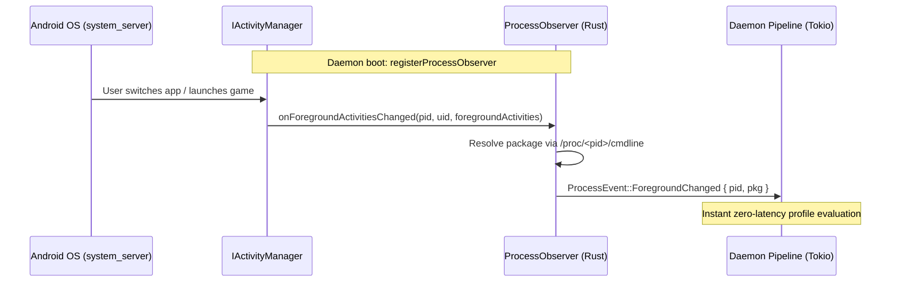

"Game detection" is how the daemon decides **which package is in the foreground**, whether it is one Auriya manages, and whether its process is still alive. Auriya receives foreground activity changes directly from Android's framework via Native Binder IPC (`IProcessObserver`), validates process identity via `/proc/<pid>/cmdline`, and tracks the active lifecycle.

:::info Verified against source
Traced to Auriya v2.2.0.
Files:
- [`src/platform/binder/observer.rs`](https://github.com/pavelc4/auriya/blob/main/src/platform/binder/observer.rs) (Native `IProcessObserver` implementation)
- [`src/platform/procfs.rs`](https://github.com/pavelc4/auriya/blob/main/src/platform/procfs.rs) (PID validity and package name resolution)
- [`src/core/session/tracker.rs`](https://github.com/pavelc4/auriya/blob/main/src/core/session/tracker.rs) (pidfd liveness and exit events)
- [`src/daemon/pipeline.rs`](https://github.com/pavelc4/auriya/blob/main/src/daemon/pipeline.rs) (the Ingest $\rightarrow$ Decide $\rightarrow$ Apply $\rightarrow$ FAS pipeline)
:::

## Where the foreground package comes from

In v2.2.0, Auriya registers a native `IProcessObserver` callback directly with Android's `IActivityManager` service over Native Binder IPC (`src/platform/binder/observer.rs`).

Whenever the Android framework switches the active task, `onForegroundActivitiesChanged(pid, uid, foregroundActivities)` fires. The observer immediately resolves the process name via `procfs::verify_pid_package` and dispatches a `ProcessEvent::ForegroundChanged` message through a bounded Tokio mpsc channel directly into the daemon engine.

This event-driven architecture delivers instantaneous zero-latency reaction times without polling files, helper APKs, or background battery drain.

An `INJECT <package>` IPC command overrides the detected foreground package for debugging; `CLEAR_INJECT` removes the override (see [IPC protocol](/internals/ipc-protocol/#state-toggles)).

## The whitelist

At startup and on every `gamelist.toml` change, the daemon maintains a `HashSet` of package names from the game list: the "whitelist". A package is considered a managed game if and only if it is in this set. Matching is **exact** (no wildcards); see [Gamelist Reference](/reference/gamelist/).

## PID validity vs. package verification

Two lightweight checks in `src/platform/procfs.rs`:

| Function | Check | Purpose |
| :--- | :--- | :--- |
| `is_pid_valid(pid)` | `pid > 0` **and** `/proc/<pid>` exists | Cheaply drop stale PID references. |
| `verify_pid_package(pid, pkg)` | Reads `/proc/<pid>/cmdline` and compares to `pkg` | Sanity-check that a PID really belongs to the expected package. |

`verify_pid_package` matches the process name up to the first `\0` or `:` separator, then also accepts a substring match so **isolated processes** named `<pkg>:<suffix>` (a common Android architecture pattern) still count as the parent package (`src/platform/procfs.rs`).

## Liveness tracking and instant exit

Once a whitelisted game's PID is validated, the daemon spawns a `PidTracker` (`src/core/session/tracker.rs`). It serves two roles:

1. **Cheap poll** — `PidTracker::is_alive()` is a non-blocking probe the pipeline loop uses on the fast path.
2. **Instant exit event** — a background thread blocks until the process actually dies and then pushes a `ProcessEvent::PidExited`, so the daemon re-evaluates *immediately* instead of waiting for the next timer tick.

Two kernel paths, chosen dynamically at runtime:

- **`pidfd_open` (Linux $\ge$ 5.3)** — the tracker opens a pidfd via raw syscall (number `434` on aarch64, `439` on x86-64) and blocks in `poll()` on it. Zero wakeups until the process exits. `is_alive` is a non-blocking `poll` on the same fd (`open_pidfd`, `pidfd_is_alive`).
- **`/proc` fallback** — on older kernels, the watcher polls `/proc/<pid>` every **150 ms** (`POLL_INTERVAL_MS = 150`), and `is_alive` falls back to a `/proc/<pid>` existence check.

An `eventfd` lets `Drop` interrupt the blocked watcher the instant the daemon stops tracking (e.g. on game switch), ensuring no lingering background threads (`tracker.rs`). The exit event is sent with `try_send`, not `blocking_send`: if the channel is full the event is dropped and the next tick catches the exit via `is_alive` to avoid deadlocks.

## How detection drives the pipeline

Each tick resolves the package and PID state (`src/daemon/pipeline.rs`):

- **Same package, PID still alive** $\rightarrow$ fast path: static tweaks are *not* reapplied; only FAS adjusts within the active session (see [Profile scheduler](/internals/profile-scheduler/)).
- **New package, or previous PID exited** $\rightarrow$ full re-evaluation.
- **Whitelisted package with a valid PID** $\rightarrow$ enter/refresh the game session (engage gaming tweaks, Wi-Fi low-latency lock, DnD, and FAS controller).
- **Not whitelisted, or PID invalid/missing, or no foreground package** $\rightarrow$ clear game state and restore the default profile.
