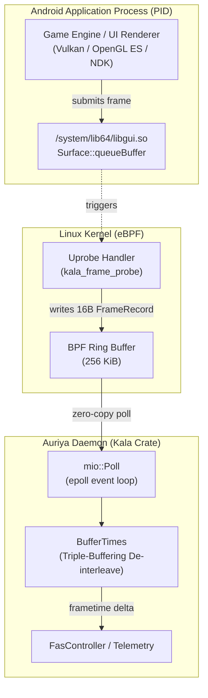

Kala ([`pavelc4/kala`](https://github.com/pavelc4/kala)) is an ultra-low-overhead, per-app frame-time probe for Android powered by eBPF uprobes on `Surface::queueBuffer` inside `/system/lib64/libgui.so`. It provides deterministic, microsecond-accurate frame pacing metrics without modifying target binaries, injecting shared libraries, or requiring ptrace.

Auriya consumes Kala directly as its core frame-time measurement source for Frame-Aware Scheduling (FAS) and benchmark analytics.

## Architecture & How Kala Works



### 1. The Kernel eBPF Probe (`ebpf/src/main.rs`)

The kernel program (`kala-ebpf-kernel`) compiles with `#![no_std]` and `#![no_main]` targeting `bpfel-unknown-none`. It hooks `Surface::queueBuffer`:

- **Arg Extraction**: Extracts `arg(1)` (`ANativeWindowBuffer* buffer`), which represents the distinct memory address of the presenting back-buffer.
- **Timestamping**: Captures hardware monotonic time via `bpf_ktime_get_ns()`.
- **Zero-Copy Ring Buffer**: Emits a 16-byte `FrameRecord` into a 256 KiB BPF ring buffer (`RING_BUF`):

```rust
#[repr(C)]
pub struct FrameRecord {
    pub ktime_ns: u64, // Monotonic timestamp in nanoseconds
    pub buffer: u64,   // ANativeWindowBuffer pointer (uniqueness key)
}
```

The 256 KiB ring buffer absorbs bursts of several hundred frames without drops even if the user-space daemon is temporarily descheduled.

### 2. ABI & C++ Name Mangling Resilience (`uprobe.rs`)

Because AOSP refactors `Surface::queueBuffer` across Android releases (Android 10 through 17 / API 37), Kala evaluates an ordered symbol fallback list:

1. `_ZN7android7Surface16hook_queueBufferEP13ANativeWindowP19ANativeWindowBufferi`: The C-API trampoline `hook_queueBuffer`. Most reliable probe point across modern devices.
2. `_ZN7android7Surface19queueBufferInternalEP13ANativeWindowP19ANativeWindowBufferi`: Internal worker called by `hook_queueBuffer`.
3. `_ZN7android7Surface11queueBufferEP19ANativeWindowBufferi`: Legacy direct entry (AOSP $\le$ 10).
4. `_ZN7android7Surface11queueBufferEP19ANativeWindowBufferiPNS_24SurfaceQueueBufferOutputE`: Legacy overload with output structure.
5. `_ZN7android7Surface11queueBufferEONS_2spINS_13GraphicBufferEEEiPNS_24SurfaceQueueBufferOutputE`: Modern `sp<GraphicBuffer>` overload (Android 12+).

The probe tries each symbol in order and binds the first one that attaches successfully.

### 3. Triple-Buffering De-interleaving & Heuristics (`tracker/mod.rs`)

Android applications utilize double- or triple-buffering, which causes buffer queue events to arrive interleaved. To extract clean frame presentation intervals:

- **Per-Buffer History**: Kala groups events by buffer pointer into `HashMap<u64, BufferHistory>`. Each buffer tracks a fixed capacity deque of up to 144 entries (`PER_BUFFER_HISTORY = 144`).
- **Delta Calculation**: Computes $\Delta t = \text{ktime}_{\text{curr}} - \text{last\_ktime}_{\text{buffer}}$ for that specific buffer.
- **Active Buffer Heuristic**: Identifies the actively presenting back-buffer by filtering buffers tied for the longest history, then selecting the one with the **smallest cumulative duration** ($\sum \Delta t$). This eliminates speculative queue noise.
- **Zero Allocation in Steady State**: After initial buffer discovery, the tracking logic performs zero heap allocations per frame (`0 alloc/frame`).

### 4. Multiplexing & Multi-Target Polling (`lib.rs`)

`FrameProbe` can track multiple PIDs concurrently using a unified `mio::Poll` engine:

- **Non-blocking Epoll**: Each attached PID's ring buffer file descriptor is registered with `mio::Interest::READABLE` using `Token(pid as usize)`.
- **Fair Round-Robin Draining (`pending: VecDeque<Pid>`)**: When epoll wakes with events for multiple PIDs, they are processed in a fair round-robin order. If a ring buffer still has queued frames, the PID is pushed to the back of `pending`, preventing a 120 FPS game from starving a 60 FPS companion process.
- **Detailed Telemetry (`recv_with_stats`)**: Returns `FrameEvent` containing:
  - `pid`: Process identifier
  - `frametime`: Calculated frame duration (`Duration`)
  - `pump_latency_ns`: Execution latency of the user-space pump logic (typically $\le 500$ ns)
  - `ring_records`: Raw BPF records consumed per frame
  - `burst_count`: Frame sequence within current epoll wake-up

## Auriya Integration

Inside Auriya (`src/core/fas/source.rs` and `src/core/stats/fps.rs`):

1. **Automatic Lifecycle Binding**: When a game enters the foreground, Auriya's Native Binder `ProcessObserver` triggers `probe.attach(pid)`.
2. **Dynamic Pacing (FAS)**: Real-time frametimes are fed to `FasController` to calculate frame jitter ($CV$), detect CPU/GPU bottlenecks, and modulate frequency ceilings.
3. **Clean Teardown**: When the process exits (`ProcessEvent::PidExited`), `probe.detach(pid)` unregisters the epoll token and unloads the kernel eBPF program. If eBPF is unsupported by the kernel, Auriya falls back to sysfs frame monitoring.
