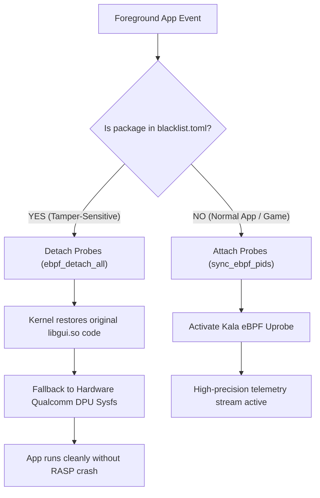

`blacklist.toml` is Auriya's configuration file for specifying application packages that are **explicitly excluded from eBPF uprobe attachment**. This prevents crashes caused by anti-tamper security mechanisms (RASP) in banking, enterprise, and DRM-protected applications.

:::note Personal Requirement & Usage Advice
This feature was implemented to fulfill a **personal requirement** by the developer, who regularly uses Indonesian digital banking applications (*blu by BCA Digital*, *BCA mobile*, *Livin' by Mandiri*, *BRImo*, etc.) on daily driver hardware.

**If you do not need this feature and do not use the blacklisted apps, you can safely ignore this configuration.** The default configuration is completely safe and does not affect gaming performance or thermal optimization in any way.
:::

## Location and Ownership

| Property | Value | Source Code |
| --- | --- | --- |
| Installed Path | `/data/adb/.config/auriya/blacklist.toml` | `src/core/config/path.rs` (`blacklist_path()`) |
| Data Format | TOML (`packages = [...]`) | `src/core/config/blacklist.rs` |
| Written By | User / Installer script | `toml/blacklist.toml` |
| Read By | **Rust Daemon** at startup and auto-reloaded on file modification | `src/daemon/watcher/config.rs` |

---

## Technical Background & Root Cause

### 1. How Kala eBPF Operates
Auriya measures frame rates and frame times with microsecond precision using the **Kala** eBPF probe engine. Kala attaches a **uprobe** (*user-space probe*) to Android's graphics library:
```text
/system/lib64/libgui.so -> android::Surface::queueBuffer
```
At the Linux kernel level, uprobes work by replacing the target function's first instruction in memory with an ARM64 software breakpoint:
- Opcode: `BRK #0x0004` (`0xd4200000`)
- Target: The entry point of `Surface::queueBuffer` in `libgui.so`'s `.text` segment.

When the application invokes `queueBuffer`, the kernel traps the breakpoint, triggers Auriya's eBPF bytecode to emit a monotonic timestamp into the BPF ring buffer, and resumes the application.

### 2. Copy-on-Write (COW) Memory Mutation
Under standard Linux operation, the `.text` code segment of shared libraries like `libgui.so` is backed by **clean, shared memory pages** mapped directly from the read-only filesystem block cache.

When a per-process uprobe breakpoint is inserted into a running process, the kernel performs a **Copy-on-Write (COW)** operation on that 4KB virtual memory page. The code page transitions into a **private dirty anonymous memory page**.

### 3. Integrity Detection by DexGuard RASP
Security-sensitive applications, particularly banking and fintech apps (such as *blu by BCA Digital* `com.bcadigital.blu`), embed **Runtime Application Self-Protection (RASP)** engines like Guardsquare DexGuard or Promon SHIELD.

During app initialization, the RASP engine verifies process memory integrity:
1. Iterates loaded ELF shared libraries via `dl_iterate_phdr`.
2. Inspects memory protection flags and page dirtiness via `/proc/self/maps`.
3. Validates binary code checksums against signatures or detects `BRK` breakpoint instructions in standard shared libraries.

When DexGuard encounters the modified, dirty COW page in `libgui.so`, it identifies memory tampering (attributing it to debugging, dynamic instrumentation, or hooking engines like Frida/Xposed). To protect credentials, it triggers an immediate self-termination:
```text
FATAL EXCEPTION: main
Process: com.bcadigital.blu, PID: 12345
java.lang.RuntimeException: Unable to start activity ComponentInfo{com.bcadigital.blu/e.eG}:
java.lang.RuntimeException: 229570587
    at android.app.ActivityThread.performLaunchActivity(ActivityThread.java:4206)
    ...
```

---

## How Auriya Solves This

Auriya addresses this natively in the daemon pipeline without needing external Magisk hide modules:



### 1. Dynamic Detection and Instant Detach
When an application listed in `blacklist.toml` enters the foreground:
- The daemon checks the package against `is_tamper_sensitive(pkg)`.
- If matched, the daemon immediately invokes `ebpf_detach_all().await`.
- The Linux kernel unhooks the uprobe, clearing the `BRK` breakpoint and restoring `libgui.so`'s code segment to clean shared memory.

### 2. Hardware Sysfs Metering Fallback
While eBPF probes are detached, Auriya does not leave FPS telemetry blind. The pipeline automatically falls back to hardware display controller sysfs counters (such as Qualcomm DPU CRTC `measured_fps` in `/sys/class/drm/sde-crtc-0/measured_fps`). FPS data continues to flow to overlays and telemetry without ever touching the banking app's memory space.

### 3. Seamless Auto Re-Attach
As soon as the user exits the blacklisted app (e.g., returning to the launcher, switching to a browser, or launching a game):
- The daemon recognizes that the active app is no longer tamper-sensitive.
- The daemon immediately invokes `sync_ebpf_pids()` to re-attach the eBPF uprobes transparently, without requiring a daemon restart.

---

## File Format: `blacklist.toml`

The `/data/adb/.config/auriya/blacklist.toml` configuration consists of a simple TOML string array:

```toml
# ==============================================================================
# Auriya Tamper-Sensitive / Blacklist Packages Configuration
# ==============================================================================
# Packages listed here will NOT be attached by eBPF uprobes on libgui.so.
# Instead, the daemon will fallback to hardware sysfs FPS calculation.
# This prevents RASP (DexGuard, Promon, etc.) tamper-detection crashes.
# ==============================================================================

packages = [
  "com.bcadigital.blu",
  "com.bca",
  "id.co.bankmandiri.livin",
  "id.co.bri.brimo",
  "id.co.bni.newmobile",
  "com.smbc.id.wondr",
  "id.co.cimbniaga.octomobile",
  "com.bankbtngn.mobilebanking",
  "com.btpn.dc",
  "id.dana",
  "com.ovo.consumer",
  "com.linkaja",
  "com.seabank.mobile",
  "id.jago.app",
  "com.bankneo.neobank",
  "com.nobubank.nobuepay",
  "id.co.maybank.m2u",
  "com.danamon.danamononline",
  "com.google.android.gms",
  "com.android.vending",
  "com.google.android.gsf",
  "com.android.systemui",
]
```

### Adding New Packages
If you encounter another banking, enterprise, or anti-cheat protected application that crashes on launch:
1. Identify the application's package name (e.g., `com.example.banking`).
2. Add the package string to the `packages` list in `/data/adb/.config/auriya/blacklist.toml`.
3. Save the file. Auriya's inotify watcher detects the file modification and reloads the blacklist immediately without restarting the daemon.
